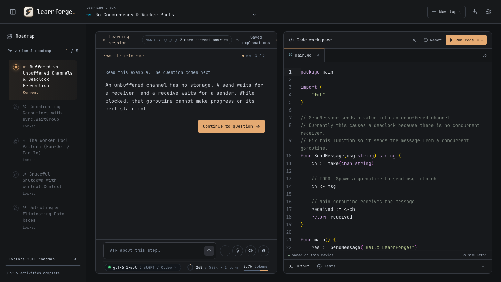
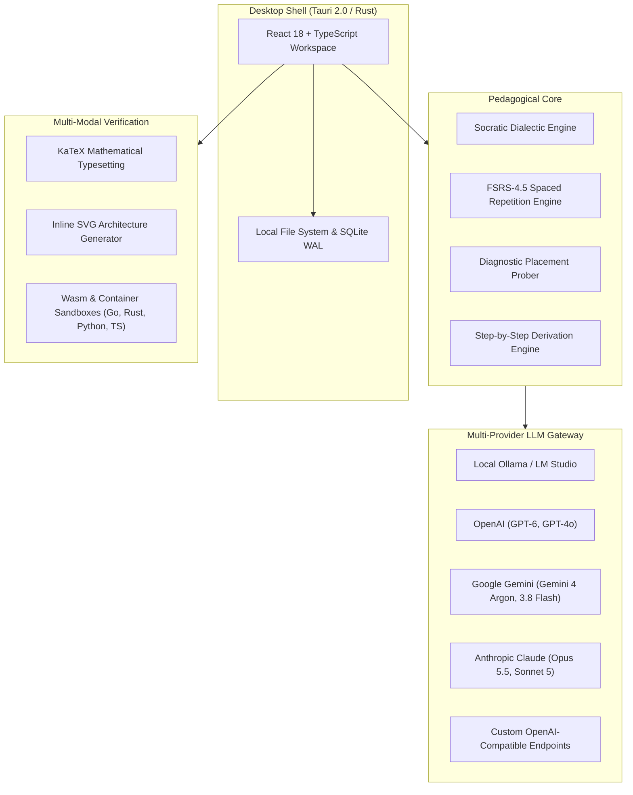
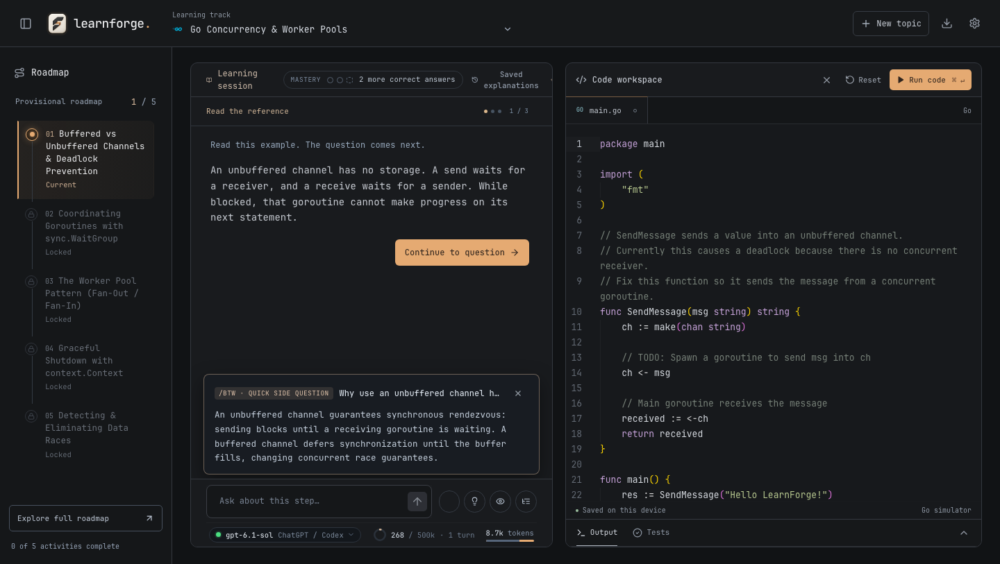
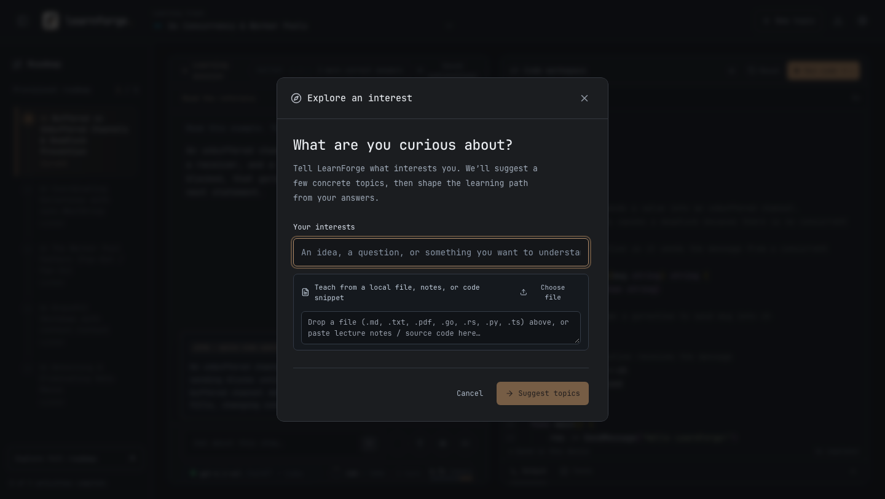
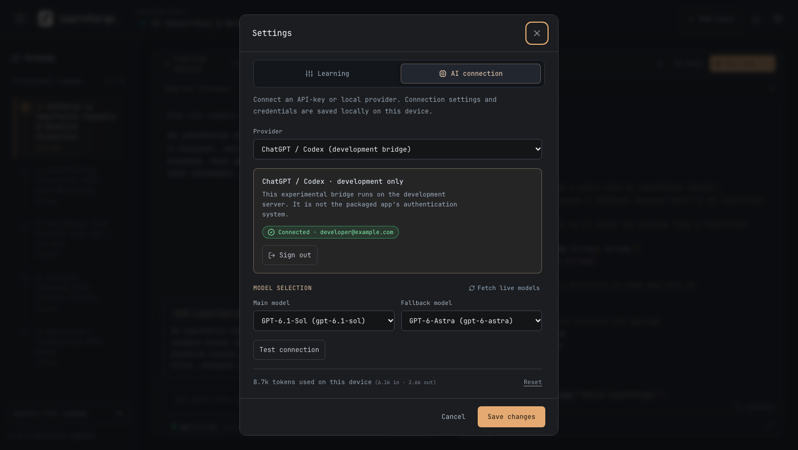

<p align="center">
  
</p>

<h1 align="center">LearnForge</h1>

<p align="center">
  <strong>A local-first, Socratic learning harness for mastering complex subjects through active recall, first-principles derivation, and verifiable practice.</strong>
</p>

<p align="center">
  <a href="#quickstart">Quickstart</a> &bull;
  <a href="#core-capabilities">Capabilities</a> &bull;
  <a href="#architecture">Architecture</a> &bull;
  <a href="#supported-ai-providers">AI Providers</a> &bull;
  <a href="LICENSE">MIT License</a>
</p>

<br />



---

## The Problem: The Illusion of Competence

Learning complex technical and scientific subjects with standard generative AI chat suffers from a fundamental cognitive flaw: **passive reading creates an illusion of competence**.

1. **Passive Reading vs. Active Retrieval:** When an LLM explains quantum computing, Bayesian inference, monetary economics, or distributed consensus across several eloquent paragraphs, the learner experiences fluent comprehension. However, fluency during reading rarely translates into recall, synthesis, or problem-solving capability when facing an empty buffer.
2. **The Fragility of Surface-Level Quizzes:** Traditional quiz interfaces test recognition rather than understanding. Multiple-choice distractors introduce deduction shortcuts, questions fail to evaluate multi-step reasoning, and interfaces lock down input so learners cannot explore tangential nuances.
3. **The Absence of Multi-Modal Verification:** Abstract concepts require multi-modal verification: formal mathematical proofs, structural visual diagrams, step-by-step state derivations, and live computational execution.

LearnForge is built around a single principle: **True comprehension requires active retrieval, formal derivation, and empirical verification.**

---

## Architecture



---

## Core Capabilities

### 1. The Never-Locked Socratic Composer and Ephemeral `/btw` Queries

In conventional educational software, once a problem or milestone is presented, the interface traps the learner into guessing an answer before permitting questions.

LearnForge decouples challenge evaluation from dialectic exploration:
- **Challenge Responses:** Submit answers, derivations, or code solutions directly for evaluation.
- **Ephemeral Side Queries (`/btw`):** Ask conceptual tangents (e.g. `"/btw how does this invariant change under network partitions?"`) without abandoning the active milestone, modifying the curriculum sequence, or clearing draft work.



### 2. First-Principles Derivation and Mathematical Rigor

Complex domains cannot be mastered through casual prose alone:
- **KaTeX Mathematical Typesetting:** Full LaTeX rendering for differential equations, matrix operations, statistical bounds, and algorithmic complexity expressions.
- **Derivation Ladders:** Step-by-step reasoning chains that break down state transformations, mathematical proofs, and logical deductions before synthesis.

### 3. Dynamic Visual Mental Models

To anchor abstract principles into durable mental models, LearnForge generates dynamic inline SVG visualizers:
- Flowcharts, state machine progressions, and data flow pipelines generated directly from topic context.
- Clean vector rendering designed natively for dark-mode contrast.

### 4. FSRS-4.5 Long-Term Cognitive Retention

Mastering difficult material is wasted if forgotten within weeks. LearnForge embeds the modern **Free Spaced Repetition Scheduler (FSRS-4.5)**:
- Calculates personalized memory stability and retrievability curves for every concept.
- Daily review decks schedule targeted retrieval sessions at optimal intervals to ensure permanent retention.

### 5. Grounding on Custom Syllabi, Notes, and Codebases

Rather than relying solely on generic pre-baked tracks, LearnForge allows learners to ground curriculum generation directly in their own source material:
- **Document Ingestion:** Drop lecture notes, research papers, textbook excerpts, or documentation (`.pdf`, `.md`, `.txt`).
- **Codebase Ingestion:** Ground topics on real repository files (`.go`, `.rs`, `.py`, `.ts`).
- **Diagnostic Probing:** 60-second placement probes gauge existing mastery to skip familiar material and target knowledge frontiers.



### 6. Built-In WebAssembly Execution Sandboxes

When studying computational, algorithmic, or systems topics, LearnForge eliminates setup friction with zero-install client-side sandboxes:
- **Go:** WebAssembly compiler and concurrent execution simulator.
- **Rust:** Native Rust playground integration with assertion verification.
- **Python:** In-browser Pyodide runtime with standard library support.
- **TypeScript & JavaScript:** Isolated worker environment with automated test harnesses.

### 7. Multi-Model Telemetry and Complete Privacy

LearnForge operates with a strict local-first architecture:
- **Zero Third-Party Telemetry:** All data, notes, and progress logs are saved locally in SQLite/IndexedDB on your device.
- **Context Fill Ring:** Live SVG gauge calibrated to each model family's context capacity (e.g. 500k for `gpt-6.1-sol`, 1M for `gemini-4-argon`, 200k for `claude-opus-5-5`).
- **Token Accounting:** Real-time visibility into prompt and completion token consumption per device.



---

## Supported AI Providers

LearnForge connects directly from your machine with zero intermediate routing servers:

| Provider | Supported Models | Configuration |
| :--- | :--- | :--- |
| **Ollama / LM Studio** | Any locally served GGUF model | Set endpoint to `http://localhost:11434/v1` (no API key required) |
| **Google Gemini** | `gemini-4-argon`, `gemini-3.8-flash-high`, `gemini-3.8-flash` | Gemini API Key |
| **OpenAI** | `gpt-6.1-sol`, `gpt-6-astra`, `gpt-6.1-terra`, `gpt-6-sol`, `gpt-4o-mini` | OpenAI API Key (`sk-...`) |
| **Anthropic Claude** | `claude-opus-5-5`, `claude-sonnet-5`, `claude-haiku-5-5` | Anthropic API Key |
| **OpenRouter** | Any OpenRouter model identifier | OpenRouter API Key |
| **Custom Proxy** | Any OpenAI-compatible completion endpoint | Custom URL + optional bearer token |

---

## Quickstart

### Prerequisites

- Node.js 20 or higher
- Rust 1.78 or higher (only required if compiling the native desktop binary)

### Web Development Mode

```bash
# Clone repository
git clone https://github.com/Oyetomi/learnforge.git
cd learnforge

# Install dependencies
npm install

# Start local development server
npm run dev
```

Open `http://localhost:5173` in your browser.

### Native Desktop Application (Tauri 2.0)

```bash
# Run desktop application in development mode
npm run tauri -- dev

# Build optimized release binaries (.app and .dmg on macOS)
npm run tauri -- build
```

Compiled desktop bundles are generated in `src-tauri/target/release/bundle/`.

---

## Test Suite

LearnForge includes comprehensive automated tests covering sandboxes, Socratic algorithms, FSRS scheduling, SVG sanitization, and model context telemetry:

```bash
# Run unit and integration tests
npm test

# Verify TypeScript compilation and production build
npm run build
```

---

## License

This project is licensed under the MIT License. See the [LICENSE](LICENSE) file for details.
