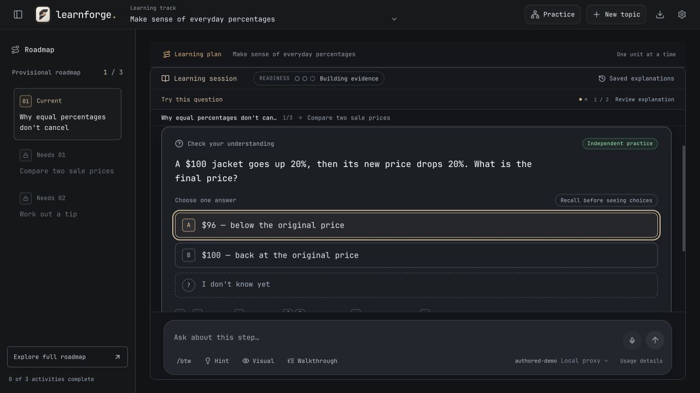
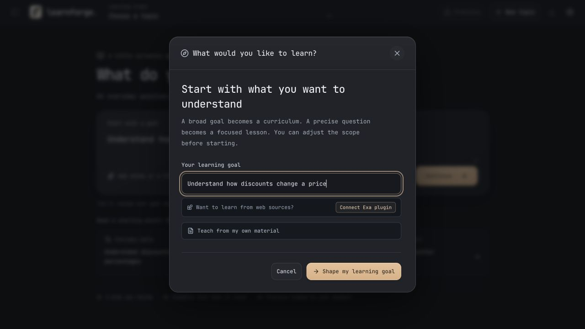
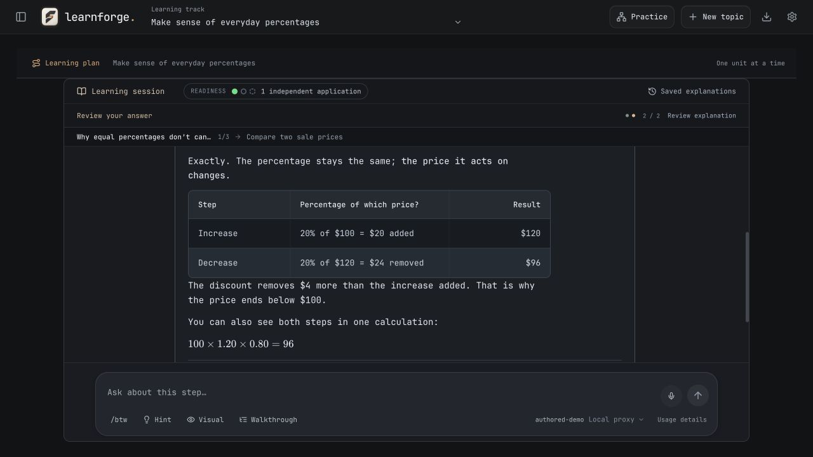
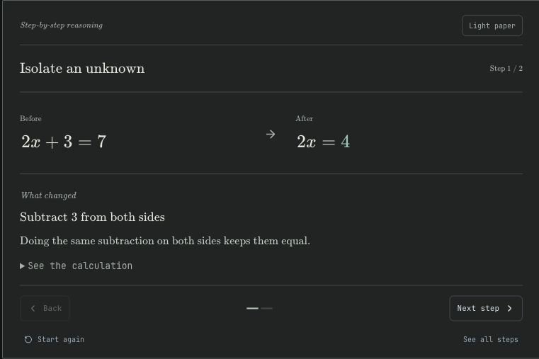
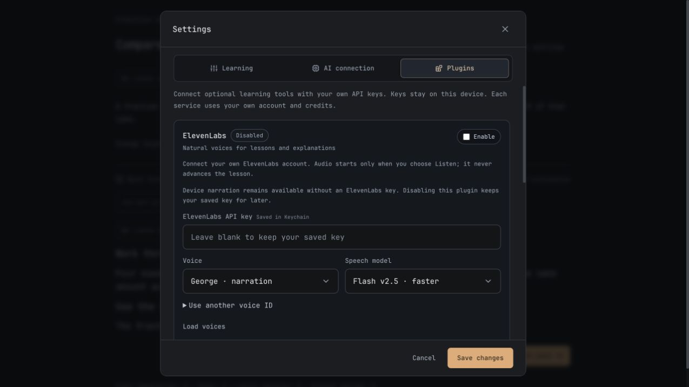

<p align="center">
  
</p>

<h1 align="center">LearnForge</h1>

<p align="center"><strong>Learn through explanations, practice, and feedback that responds to your answers.</strong></p>

<p align="center">
  <a href="https://github.com/Oyetomi/learnforge/releases/latest">Download for Mac</a> ·
  <a href="#how-it-works">How it works</a> ·
  <a href="#features">Features</a> ·
  <a href="#development">Development</a> ·
  <a href="docs/release-0.2.4.md">Verification notes</a>
</p>

<p align="center">
  <a href="https://github.com/Oyetomi/learnforge/releases/latest"></a>
  <a href="https://github.com/Oyetomi/learnforge/actions/workflows/ci.yml"></a>
  <a href="LICENSE"></a>
</p>



*A provider-generated Yoruba greeting session in the current app: review your answer, read the explanation, and continue at your own pace.*

LearnForge is a local-first learning app for technical and nontechnical subjects. Start with something you want to understand, review the proposed scope, and learn through examples and fresh applications. Bring your own AI provider or a compatible local model server.

## Get started

1. [Download the latest release](https://github.com/Oyetomi/learnforge/releases/latest). Apple Silicon Mac downloads include a DMG, an app ZIP, and `SHA256SUMS`. The current Mac build is ad-hoc signed and is **not notarized by Apple**.
2. Open **Settings → AI connection**. Choose a provider, enter your own key or endpoint where needed, select a model, and test the connection. The default local-proxy preset requires a running server; the app does not bundle an AI model.
3. Choose **New topic** and describe your goal. Review a full curriculum for a broad goal, or a focused lesson for a specific question.

## How it works

1. **Find a starting point.** An optional diagnostic checks what to explain first. Asking to start with a diagnostic selects it for focused lessons too. “I’m not sure” is a valid answer.
2. **Review the plan.** Inspect the proposed concepts and scope before adding them to your workspace.
3. **Learn and apply.** Read an explanation, then answer a choice, written-response, or prediction question. Coding practice is optional.
4. **Work through feedback.** Your submitted answer stays available while the tutor explains it. Continue when you are ready; a wrong or uncertain answer can lead to a smaller guided example.
5. **Try a fresh case.** Supported practice is tracked separately. Independent applications, transfer to a different situation, and a tutor review guide readiness for the next concept.



*Interest-first onboarding in the current app. A goal can also use uploaded notes or source material.*

## Features

| Feature | What it does |
| --- | --- |
| Adaptive learning flow | Uses answers, confidence, reasoning, and help usage to adjust guidance and the next activity. |
| Worked tutoring | Explains correct, wrong, uncertain, and disputed answers before another question. Read one part at a time or read together. |
| Help without losing your place | Ask a side question with `/btw`, or open a hint, walkthrough, or visual alongside the current activity. |
| Math and visual explanations | KaTeX equations, paper-style derivations, comparison tables, SVG illustrations, and supported interactive models. Embedded calculations stay together; standalone figures can retain step controls. |
| Your own material | Use text, Markdown, PDFs, code files, or pasted notes as source context. Extraction and model interpretation have limits. |
| Study notes | Export study material as Markdown or Anki-compatible data. |
| Optional revisits | Offer an earlier idea within the same topic. Off by default, integrated into learning rather than a daily-review modal. |
| Optional coding | Syntax-highlighted examples and an editor with explicit execution providers. |



*Question review from the same greeting session. Readiness is an application decision, not a guarantee of mastery.*



*An authored algebra example rendered with the production figure component. KaTeX supports mathematical notation, not full LaTeX documents or arbitrary TikZ.*

More detail: [curriculum design](docs/curriculum-product-design.md), [post-answer tutoring](docs/post-answer-tutoring.md), [visual models](docs/declarative-visuals.md), [mathematical visuals](docs/latex-visual-learning.md), and [question review](docs/question-trust.md).

## Optional plugins and narration

Configure integrations under **Settings → Plugins** using your own accounts and keys.

- **Exa:** search and reference extraction for source-grounded learning. You can choose grounding per topic.
- **ElevenLabs:** read lessons and explanations aloud in the Mac app. Set your key, voice, and speech model. Audio starts only when you press Listen and never advances a lesson. Disabling the plugin selects device narration and retains your saved key for later.

ElevenLabs keys are stored in macOS Keychain. Device narration is available without an ElevenLabs key. Cloud narration uses the selected service’s credits; voice discovery may require additional API permissions. See [narration setup and limits](docs/narration.md).



*Mac plugin settings, captured with an authored native-bridge fixture and no live credentials.*

## AI connections and code execution

Settings includes presets for OpenAI, Gemini, Anthropic, OpenRouter, Ollama, a local proxy, and custom OpenAI-compatible endpoints. Endpoint compatibility, available models, context limits, and account access depend on the service. Model presets are editable; a listed model is not a guarantee that your account can use it. The ChatGPT/Codex subscription bridge is a **development-server integration**, not packaged Mac authentication.

The optional editor identifies the execution provider before Run:

| Code | Execution |
| --- | --- |
| Go | Go Playground |
| Rust | Rust Playground |
| Other available compiler languages | Wandbox’s discovered runtime catalog |
| JavaScript / TypeScript | Local browser worker with lightweight TypeScript stripping |

Remote execution sends code and tests to its provider. Runtime, package, network, and service limits apply; unavailable languages remain editor-only. The browser worker is not a Node.js or full TypeScript project runtime. See [execution behavior and limits](docs/code-execution.md).

## Data and privacy

Learning records and settings use local browser/WebView storage. AI connection keys and Exa settings are stored locally; ElevenLabs uses macOS Keychain. Do not assume all credentials have OS-backed encryption or that local-first means offline.

Requests to a configured AI service send the context needed for the activity, which can include your answers and supplied source excerpts. Exa grounding, cloud code execution, and cloud narration contact their respective services when used. No user API key is included with the app.

## Development

Use Node.js and npm for the web app. Native builds also require Rust and the [Tauri platform prerequisites](https://v2.tauri.app/start/prerequisites/); macOS desktop builds need Xcode or its Command Line Tools.

```sh
git clone https://github.com/Oyetomi/learnforge.git
cd learnforge
npm ci
npm run dev
```

Open the local URL printed by Vite, normally `http://localhost:5173`. Configure an AI connection in Settings; running the dev server alone does not start a model server.

```sh
npm test                         # Frontend tests
npm run build                    # TypeScript + production web build
npm run tauri -- dev             # Native development
npm run tauri -- build           # Native release bundles
cd src-tauri && cargo test       # Native tests
```

Desktop bundles are written to `src-tauri/target/release/bundle/`.

The UI uses React, TypeScript, and Vite inside a Tauri/Rust desktop shell. AI requests go through a shared provider adapter. Learning state, assessment evidence, and optional help remain separate from figure rendering and code execution. See [the source verification report](docs/release-0.2.4.md) for what was tested.

## Current limits

AI-generated questions, grading, explanations, and visuals can be wrong. Placement and readiness are estimates. Language content needs native-speaker review; optional revisits do not guarantee retention. Software tests and scripted walkthroughs do not establish improved human learning or superiority over another product.

Report a reproducible problem in [GitHub Issues](https://github.com/Oyetomi/learnforge/issues). Include the app version, what you expected, and what happened; remove API keys and private source material from screenshots or logs.

## License

[MIT](LICENSE).
