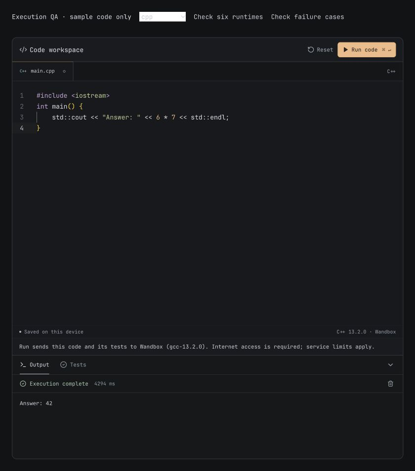

# Code execution in LearnForge

Updated 28 October 2026.

## What Run does

The code editor and an execution engine are separate. Syntax highlighting does not prove a runtime exists. An AI provider key is also separate from a compiler service; generated output is not evidence of execution.

| Language | Execution engine | Scope |
| --- | --- | --- |
| Go | Go Playground, `play.golang.org/compile` | Real compiler and test runner, sandbox restrictions |
| Rust | Rust Playground | Stable Rust, code or native test mode, playground restrictions |
| Python | Wandbox CPython | Stable Python 3 compiler discovered from current catalog |
| C, C++, Java, C#, Bash, SQL and others | Wandbox | Only languages and compilers currently listed by the service |
| JavaScript, TypeScript | Browser worker | Browser APIs and a small test harness; no Node modules, package installation or full TypeScript type checking |

Wandbox's catalog contained 176 compiler entries across 35 language labels when checked. That is a service snapshot, not a promise that every language is supported. Kotlin, for example, was absent. SQL is now resolved to an actual SQLite runtime. A language absent from the catalog is editor-only and Run is disabled. A failed catalog request permits an explicit Run to retry discovery; it does not assume a compiler exists.

The editor displays the provider and compiler version, and states that cloud execution sends the source and supplied tests to that provider. It fetches public compiler metadata when opened but submits code only on Run. None of these adapters requests a saved public permalink (`save: false` for Wandbox). This does not guarantee a provider's data retention policy.

## Corrections

- Topic creation preserves programming languages beyond the original five. Learning a language and having a runnable runtime are separate; unavailable languages remain editable rather than being silently replaced by Go/Python.
- Discover stable compiler IDs from the catalog rather than guessing version strings. Cache successful catalogs for five minutes and share in-flight lookups. Failed lookups are retryable.
- Use Tauri's native HTTP plugin in the packaged app. Its capability scope permits the specific Go compilation endpoint, Wandbox API, and existing Rust Playground endpoint. Browser builds use ordinary fetch.
- Go and Python no longer silently switch to partial simulators after network failures. Limited evaluators remain reachable only through an explicit internal `forceBuiltinRunner` option, used by their unit tests.
- Preserve Go source and tests in separate Playground archive files. Test detection runs the real Go test runner, including `t.Fatal`, rather than constructing an unsupported `testing.T` by hand. Imports and aliases remain intact, and a source `main()` does not bypass tests.
- Use `play.golang.org/compile`, which returns `Status` and test metadata. A live comparison found `go.dev/_/compile` omits these fields, including for `os.Exit(7)`, so it cannot establish execution success reliably. Normal stderr is not itself a failure.
- Preserve Python test setup and multiline assertions. Top-level assertions receive individual results; other suite statements execute normally. A failing assertion produces a failing overall result. This is not a pytest/unittest discovery engine.
- Keep compile errors, runtime diagnostics and termination signals. Reject malformed service responses. Do not automatically repeat execution POSTs after rate limiting.
- Bundle syntax definitions for the additional editor languages and show their actual file labels, rather than marking C++ as JavaScript.

## Validation

- Automated tests (205 passing across 32 files): adapter payloads/results, absent languages, SQL and additional catalog languages, stable selection, catalog caching/recovery, native transport routing, error propagation, preserved tests, and existing explicit simulator behavior. Unit tests mock network services and do not depend on their uptime.
- Live browser verification uses an ignored, sample-only fixture at `.lazyweb/runtime-qa/`. C++, Python, SQLite, JavaScript, Go and Rust each returned expected output through `executeCode`. No learner code or saved learning state was used.
- Live failure checks: Go `t.Fatal` marks one test failed while a second test still runs; `os.Exit(7)` is a failed execution; a Python suite retains setup/multiline assertions and reports one pass/one failure; invalid Rust receives a compiler diagnostic.
- Native bundle compilation validates the HTTP capability configuration. Native execution transport is covered by a mocked routing test; real packaged execution has not been observed in this pass.

## Practical limits

These are small-program sandboxes, not complete development machines. Interactive stdin, filesystem persistence, GUI applications, package managers, multi-file arbitrary projects, full dependency environments and an unlimited execution budget are not provided. Go's sandbox has its own time, network, cgo and platform constraints. Cloud outages and rate limits remain visible failures.

A managed or self-hosted execution service would be needed for predictable production capacity and custom runtime environments. No Piston/Judge0 settings or managed backend has been implemented, despite an earlier adapter comment claiming one existed. No paid service was provisioned.

## Primary references

- [Wandbox live compiler catalog](https://wandbox.org/api/list.json) — language/ID discovery and current available versions.
- [Wandbox repository](https://github.com/melpon/wandbox) — service and availability limitations; its linked legacy API markdown currently returns 404.
- [Go Playground implementation](https://github.com/golang/playground/blob/master/sandbox.go) — response status, test detection, compilation and runtime constraints.
- [Inside the Go Playground](https://go.dev/blog/playground) — sandbox design and execution model.
- [Rust Playground source](https://github.com/rust-lang/rust-playground) — execution service implementation.

