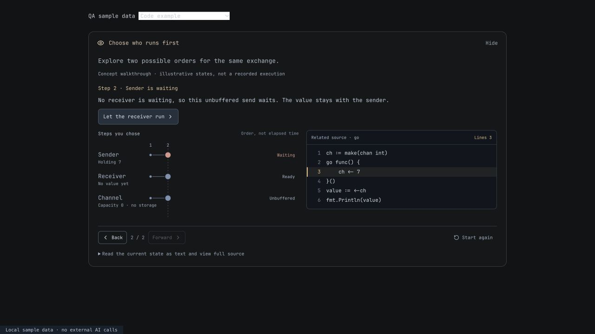
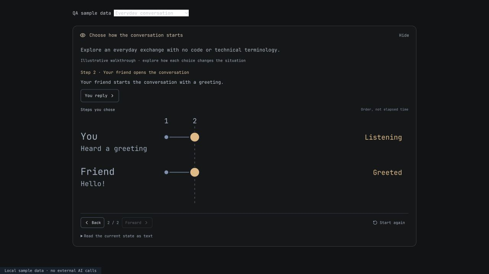

# Reusable concept walkthroughs

28 October 2026.

## User requirement and resulting design

The renderer must not contain a separate behavior model for each programming language. A concurrency example is a use case, not the architecture.

New `state-model` visuals are **data-driven and subject-neutral**. The lesson supplies participants/concepts/resources, state snapshots, allowed actions, explanations, and optional source text with relevant line numbers. One renderer displays that data and lets the learner explore it. It does not choose a runtime model based on `go`, `python` or any other language name. The source-language string affects syntax highlighting only; an unknown language remains readable as plain text. Non-coding topics omit source entirely.

Neither the channel example nor the conversation example used in QA is installed as a starter topic or encoded as a production behavior handler. They are disposable fixture data in the ignored `.lazyweb/state-model-qa/` directory. Tests also contain explicit sample data, as expected for validation.

## Interaction

- Choose an authored action and see its resulting snapshot and explanation immediately.
- The same data supplies entity lanes, status labels, values and source-line highlights. Colors supplement text rather than replacing it.
- Back and Forward replay existing visits without contacting the AI.
- Choosing a different action after going Back replaces the old future with the new branch.
- Reset returns to the lesson's supplied initial state. Cycles are allowed, with a 32-visit bound per exploration.
- The timeline shows chosen steps, not wall-clock time or a measured scheduler trace.
- New explanations receive focus after an action and are scrolled into view when needed. Keyboard users can then reach the next actions in document order.
- The visual gets its own focused activity, keeping the question action visible. Question drafts and feedback remain in the existing lesson flow.
- Opening or manipulating a visual for a pending check records support. It cannot independently prove competence or unlock the roadmap.

The model itself and any supplied code remain data. Source is never run by this renderer. Real code execution remains the separate editor/Run feature.

## Contract

`VisualExample.kind` is `state-model`, alongside the existing title, summary, items and takeaway. Its `stateModel` contains:

| Field | Meaning and bounds |
| --- | --- |
| `version` | Exactly `1` |
| `initialStateId` | An existing state ID |
| `entities` | 1–6 unique `{id,label}` entries; these may be any relevant entities, not fixed goroutine types |
| `states` | 2–20 unique `{id,label,description,entities}` snapshots |
| Each snapshot's `entities` | Exactly one `{entityId,status,value,tone}` for every declared entity |
| `tone` | `neutral`, `active`, `waiting` or `done`; display emphasis only, not behavior semantics |
| `transitions` | 1–40 unique `{id,from,to,label,explanation,sourceLines?}` entries; at most 4 outgoing choices per state |
| `source` | Optional `{language,code}`; at most 60 lines / 6,000 characters |
| `sourceLines` | Optional unique, valid 1-based source line numbers for an action |

IDs, text sizes and references are bounded. All states must be reachable from the initial state. Duplicate IDs, dangling references, missing entity snapshots, self-transitions, unsupported versions and invalid source positions are rejected. Extra callback/HTML/script fields are dropped. Model strings render as escaped text; code highlighting uses the existing escaping highlighter. Runtime validation also protects a malformed stored descriptor with a readable fallback.

The UI never accepts generated callback functions, JavaScript guards, arbitrary SVG or executable transition logic. A transition selects a destination snapshot; it does not evaluate an expression supplied by the model.

## Generation and old content

Both lesson generation and tutor responses receive the generic contract. They are instructed to derive the actual states and entities from the learner's current concept and source, prefer a small experiment, respect visual preferences, and use a related example rather than answering an outstanding assessment.

The former fixed Go-only model recommendations were removed from the generation instructions. The new content acceptance path rejects the old fixed-simulation kind for **every** language; it no longer tests a language name to decide which model is allowed. Existing saved fixed-model activities retain their renderer for compatibility and are not deleted or rewritten. Requesting a fresh visual uses the new instructions. Mathematical graphs and guided notation remain useful separate representations, without a programming-language gate.

## What this establishes—and what it does not

These are interactive, authored concept walkthroughs. The UI explicitly distinguishes them from recorded execution. The validator checks structure and boundedness, **not** whether AI-authored states correctly describe source code, language semantics or a real physical process. Live model generation quality was not evaluated in this pass; browser QA used authored local sample descriptors and blocked external AI requests. If reliable states cannot be supplied, the prompt asks for a simpler illustration and a stated limitation.

This is not a universal debugger, scheduler, interpreter or physical simulation engine. It also does not guarantee automatic adaptation or learning gains. Domain review and learner evaluation remain necessary. Exploration history is component state and may reset when leaving/remounting the visual; assessment drafts remain durable separately.

## Verification

- **223 tests passed across 34 files.** New tests cover language-independent acceptance, no-source topics, invalid references, exact snapshot coverage, source bounds, escaping, immutable histories, alternative paths, replay, cycles and history limits.
- Browser checks used the same component with a channel exchange, a different queue example/source language, and an everyday conversation without code.
- Branching from an earlier step discarded the old future; source highlights followed the newly selected action. The terminal state did not advance the lesson or call AI.
- Keyboard activation updated the state and moved focus to the explanation.
- At a 350px container width, the card, source pane, actions and navigation stayed within their container without horizontal page overflow.
- A selected answer survived a visual detour. Submission showed supported-practice feedback and paused on Continue; readiness did not increase from the visual.
- The macOS Tauri bundle was built. The running user app and its learning data were left untouched.

## References

- [W3C: complex images](https://www.w3.org/WAI/tutorials/images/complex/) — why graphical state information also needs an equivalent explanation.
- [IES: organizing instruction and study](https://ies.ed.gov/ncee/wwc/PracticeGuide/1) — supports combining graphics with words and connecting examples to subsequent practice; it does not validate this exact UI.
- [Go specification: channels](https://go.dev/ref/spec#Channel_types) and [Go memory model](https://go.dev/ref/mem#Channel_communication) — references used to check the disposable concurrency example, not a language-specific implementation dependency.

## Sample previews

