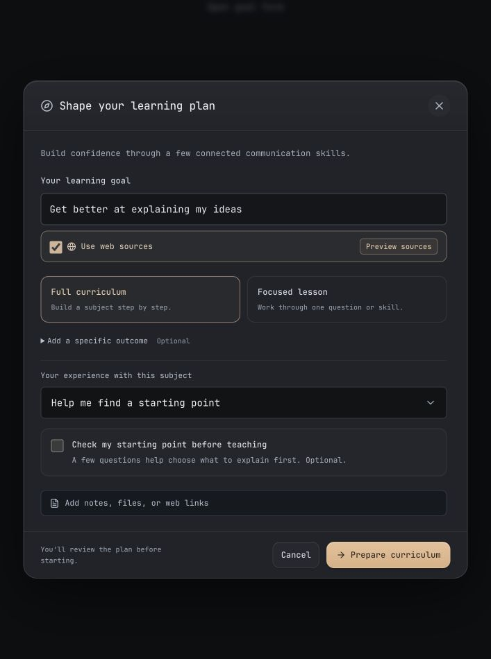

# Goal-planning form repair

3 November 2026. The reported form let its starting-point checkbox take the text input's `width: 100%`, pushing its label outside the content area and creating horizontal scrolling.

- Text fields and binary inputs now have separate sizing rules. The form's grid uses a bounded column, and children can shrink within it.
- Curriculum and focused-lesson choices include short descriptions. The optional specific outcome is a disclosure, and experience choices have shorter visible labels while retaining their stored values.
- One optional starting-point check replaces the duplicate calibration action. Its answered count includes “I'm not sure”; preparation remains disabled until every displayed question has a response. Skipping clears the questions and validation error.
- The footer sits outside the scrolling body. Its submit button explicitly belongs to `new-topic-form`, so validation and the existing preparation handler still run.

The screenshots use the production modal with authored offline scope and question responses. The Exa-ready state is simulated without credentials or external requests. They establish layout and interaction behavior, not live source search or teaching quality.

Browser checks covered both scope choices, optional placement, unknown responses, the 0/3 → 1/3 → complete transition, submission gating, and skipping. At 1280 × 720 and 390 × 844, the measured form scroll width equals its client width, the checkbox stays 18px wide, and the footer remains inside the viewport. See [geometry.json](geometry.json) and the [narrow layout](narrow.jpg).

All 467 frontend tests pass. TypeScript, production web and Tauri macOS builds pass. The rebuilt Mac app is installed with an ad-hoc signature and matching bundle hashes; reopening the app loads it. Existing large-bundle warnings remain. No signed-in native session was restarted for this check.
