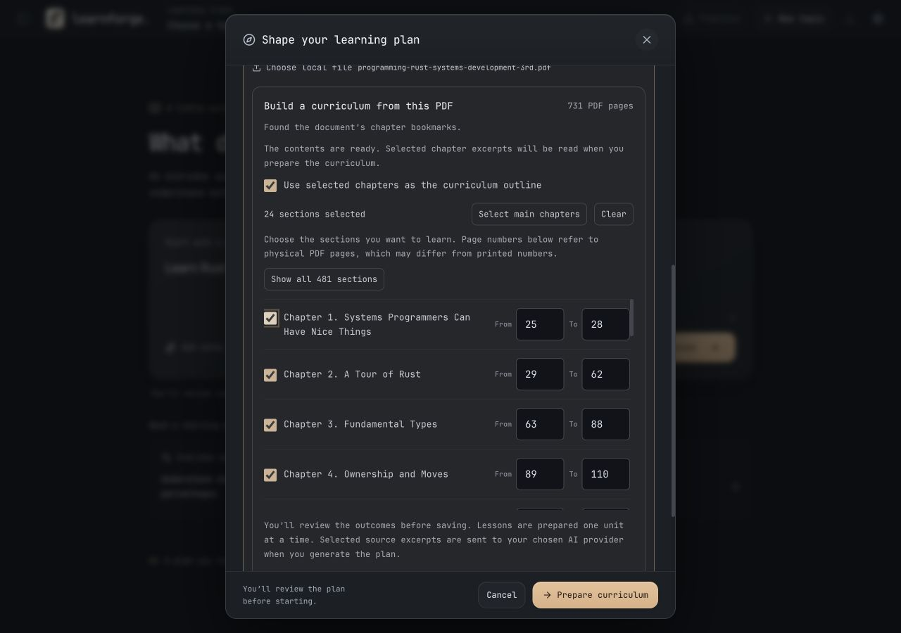
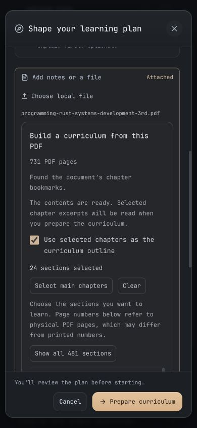

# PDF curriculum import QA · 5 November 2026

The user’s local 731-page Rust textbook was imported through the actual file picker with Mozilla PDF.js and local byte-range loading. Its 481 bookmark entries were detected. The default picker showed 24 main chapters, with detailed sections available on demand and nonteaching front matter excluded from the default selection.

Selected Chapter 19 (physical PDF pages 517–560) and Chapter 24 (681–708), read their excerpts through the same chunked transport, and generated an outline using authored offline model responses. The review retained both chapter names and page ranges. No book content was sent to a live model or external document service. The book itself is not stored in this repository.

At 1280 × 900 the picker remained inside its modal, and the primary action stayed visible. At 390 × 844 the document width was 390 px, modal width 370 px, and picker scroll width 299 px: no horizontal overflow. Source text preview, detailed sections, and the chapter list use disclosures/scrolling to keep the main form bounded.

Additional authored PDF fixtures cover printed contents with front-matter offsets, missing contents with a pasted-list fallback, and image-only document errors. Automated tests cover omission/invention of chapter IDs, source persistence, later-chapter context, cancellation, worker cleanup, file ranges and extraction. A simulated 3 GB / 6,001-page transport checks the absence of size/page-count rejection without allocating a 3 GB test file. It is not a benchmark of a real file that size.

484 tests across 70 files passed. TypeScript, production web, and macOS Tauri builds passed. The app was signed and installed at `/Applications/LearnForge.app`; all four installed bundle file hashes matched the verified build. The running app was left open; reopening loads the new binary. Source publication is handled separately from the local import verification.

See [the feature guide](../../pdf-curriculum.md) for behavior, extraction limits, source handling, and reproduction steps.
