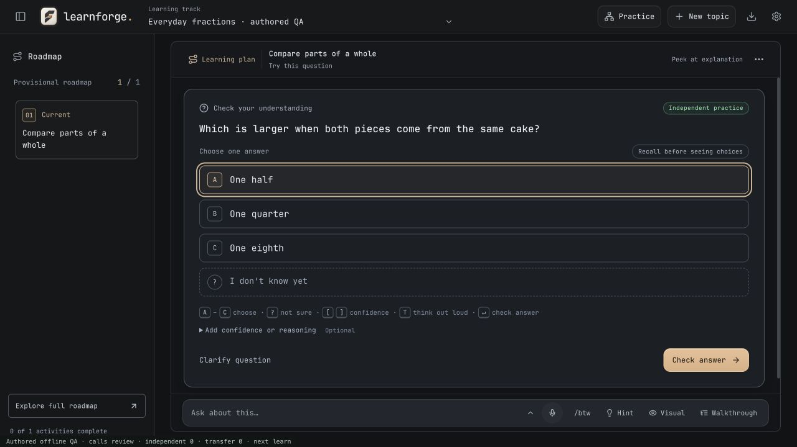
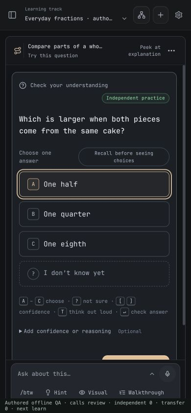

# Learning session layout · 3 November 2026

The session now reserves more of the window for the current learning activity. One header replaces the curriculum context bar, session toolbar, activity bar, and route strip. It shows the current concept and activity, a direct route to the learning plan, and a contextual explanation/question action. Readiness, the route, saved explanations, coding tools when relevant, and AI connection settings remain available through **Session details and tools**.

The composer starts as a single line. Typing, dictation, or the expand control opens the editing area and model/usage controls. Escape or the collapse control closes it without clearing or sending the draft. A reload restores a nonempty draft in its expanded state. Short desktop windows use tighter spacing around optional question controls; question and answer fonts were not reduced.

## Verified geometry

Measured through the running production React components at 1280 × 720, with the learning path open:

| Measurement | Result |
|---|---:|
| Session header | 58 px |
| Collapsed composer rail | 61 px |
| Activity viewport bottom | y = 634 |
| Submit button bottom | y = 598.75 |
| Activity scroll position | 0 |
| Question text | 16 px |
| Answer text | 14.5 px |

All three choices, “I don’t know yet,” optional reasoning disclosure, and the submit button fit without scrolling in this short-question case. Long questions, code, expanded reasoning, and narrow windows still scroll normally; content is not clipped or hidden to force a fit.

At 390 × 844, both document and body widths were 390 px. The composer uses two rows, and expands without horizontal overflow. The question scrolls vertically at this size.

## Interaction checks

- Selected an answer, typed an unsent message, collapsed it, pressed Escape, and reloaded: the answer and message draft survived, with no message request sent.
- Opened a hint and returned: the selected answer survived. Help switched the attempt to supported practice.
- Opened the consolidated explanation action: the lesson appeared alongside the same question, with an open-book/supported-practice label. Closing it did not erase that support evidence.
- Opened the learning plan and returned: the same question and answer selection survived.
- Opened session tools, pressed Escape: the disclosure closed and focus returned to its trigger. Opened saved explanations and closed the dialog: focus returned to the same trigger.
- Completed an authored mistake → nudge → full tutoring → guided → independent → changed-whole transfer → readiness review sequence. Feedback held the submitted answer until an explicit continuation. Guided success left independent evidence at zero; independent and transfer successes produced two independent applications, including one transfer case. Only the subsequent authored tutor review approved the concept.

These checks used authored offline provider responses, not a live model or human learners. They verify layout, state preservation, and progression wiring; they do not establish teaching quality or superiority to another product.

## Reproduce

Run `npm run dev -- --host 127.0.0.1 --port 5257 --strictPort`, then open `http://localhost:5257/scripts/screenshots/session-layout.html` in a disposable browser origin/profile. The fixture seeds an authored fractions track and intercepts all fetch requests with offline responses. It contains no credentials and does not call a provider. Do not use a browser origin containing personal learning data: the fixture replaces the local track/session records on its first visit. A small bottom strip labels the authored QA and reports fixture progression; it is not part of the product UI.

Automated verification: 470 tests across 67 files passed, including draft collapse/reload, deliberate submission, streaming protection, and dictation append regressions. TypeScript, the production web build, and the Tauri macOS app build passed. The installed `/Applications/LearnForge.app` was replaced with a signed build and all four bundle file hashes matched the verified build. The previous app bundle is retained in the local install backup directory.
