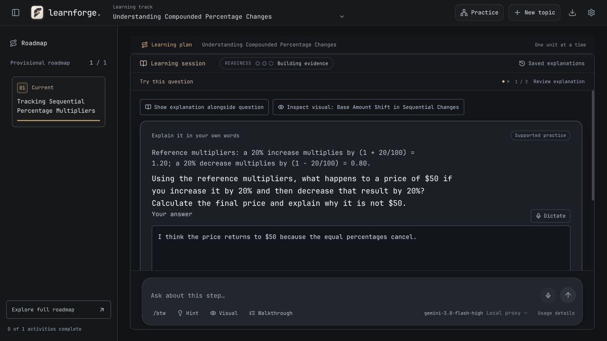

# Same-model app walkthrough: percentages

3 November 2026. **Partial live comparison, interrupted by provider quota.** Responses were authored by the tester. No human learning, transfer or retention outcomes were measured.

This run verifies that both apps began with diagnostics and records a concrete navigation repair in LearnForge. It does **not** establish that LearnForge teaches better than LearnHarness. The shared provider failed before LearnHarness's first teaching turn completed, so comparing complete teaching cycles would be misleading.

## Setup

- LearnForge: version 0.2.4, baseline `87eef11514d9cd47011362afa411dc0ce2afff59`, plus the source repairs fingerprinted in [manifest.json](manifest.json). Actual production App running through Vite at a fresh localhost origin; no injected lesson responses.
- LearnHarness: fresh public checkout `e69e85269c064c6c9c49a8b06ae78c06e79c4a63`, version 0.4.1, in an isolated temporary directory with its own empty data directory. The user's existing checkout, sessions and native app were not edited. Automatic knowledge-graph extraction was disabled to bound this core-session walkthrough.
- Both requested `gemini-3.8-flash-high` through separate transparent, localhost-only metered transports forwarding to the same upstream chat-completions endpoint. Successful responses reported that same model ID. This verifies request/response labels, not the identity of the provider's underlying weights.
- Each transport had a maximum of 24 requests and a 90-second request deadline. It forwarded request bodies and streamed response chunks without changing prompts or sampling. No credentials or existing personal lessons were copied.
- Native product configurations were retained otherwise: LearnHarness selected thinking `off` and used tools/streaming; LearnForge used its own structured preparation and sampling. Discovery advertised one model with a 272,000-token context and 16,384 output limit as evaluation configuration, not measured provider capabilities.
- Both used the default browser viewport, 1280 × 720. This is a browser interaction check, not verification of packaged Mac builds or every responsive size.

The same brief was entered in both apps:

> Help me understand why increasing a price by 20% and then decreasing it by 20% does not usually restore the starting price. I know basic multiplication, but percentages confuse me. Start with a short diagnostic before explaining, adapt to my reasoning, and keep this a focused lesson. Reference for this exercise: a p% increase multiplies the current amount by 1 + p/100; a p% decrease multiplies the current amount by 1 - p/100. Each step uses the amount at that step, with no rounding, fees, or other changes. Use only this supplied reference; no external research.

The draft task pack has not received independent domain review. Withheld transfer and delayed-retrieval cases were not supplied to either tutor. No accuracy percentage, speed ranking, placement score or winner is calculated.

## What happened

| Stage | LearnForge | LearnHarness |
| --- | --- | --- |
| Diagnostic first | Explicit starting-point check before plan generation and teaching | A final-price probe before teaching |
| Diagnostic format | Three questions presented together: increase multiplier, combined operation, and why the base matters | Adaptive probes one at a time: final price, dollar discount, then combined multipliers |
| Tester responses | Correct multiplier 1.20; incorrect cancellation expression; “I'm not sure” on changing bases | Incorrect $100 final price; correct $24 discount from $120; “I don't know” on combined multipliers |
| Reasoning supplied | No optional placement reasoning/confidence entered | Cancellation reasoning, explicit 0.20 × 120 arithmetic, then uncertainty about composing multipliers; confidence left at default 50% |
| Plan | One focused concept, approved explicitly; placement not presented as mastery | Two diagnosed boundaries and a five-part teaching plan; approval requested |
| Teaching reached | Explanation and a complete $100 → +10% → $110 → −10% → $99 worked example; then a written $50, +20%, −20% application | Plan approved, but first teaching response failed with an upstream quota error |

These are **different question sets and information histories**, despite the same initial brief and model ID. They are useful product observations, not matched learner scores. LearnHarness's diagnosis had written reasoning that LearnForge's placement did not receive. This run cannot establish which diagnosis is more accurate.

### Observed provider failure

LearnHarness's eighth upstream request returned HTTP 500 containing the provider's `429 RESOURCE_EXHAUSTED` quota error. The UI displayed an error and a Retry control. No retry or alternate model was used after this failure, and no more provider requests were submitted in either app. The limit came from upstream, not either transport's 24-request cap. LearnForge made four successful preparation/review requests; LearnHarness made seven successful requests before the failure.

This is not evidence that LearnHarness is unreliable or that LearnForge would have succeeded on the same request. Its user-facing error exposes technical provider detail, but this work does not modify LearnHarness.

[Provider failure](harness-provider-failure.jpg) · [captured UI](harness-provider-failure.txt)

## LearnForge repairs delivered

### Make the question action predictable

Before the repair, the final lesson button **“Try this idea” opened a full visual activity**, rather than the pending question. The figure then offered “Back to question,” although the question had not been visited. This reproduced the user's confusion about nested lesson/figure navigation.

The final action is now **“Try a question”** and goes directly to the question or its required reference screen. **“Explore the example”** is a separate optional action when an automatic lesson figure is available. The figure and lesson toolbar use **“Open question”** without implying a previous visit. Existing help access, figures and supported-practice tracking remain available.

The actual provider-generated lesson was reused to verify the fix without further model calls:

1. Typed the deliberately incorrect draft “I think the price returns to $50 because the equal percentages cancel.” It was **not submitted or graded**.
2. Refreshed and verified the same question and draft restored.
3. Opened the explanation, clicked “Try a question,” and verified the pending question appeared directly with the draft intact.
4. Opened “Explore the example” separately and activated its +10% transition. The figure changed from $100 to $110 and updated its base and caption.
5. Used “Open question” and verified the original draft remained available.

The activity was labeled supported after reviewing the example/explanation. This run does not claim independent credit for that work.

### Preserve support boundaries in saved evidence

Source review found a defensive gap for saved/legacy records, not a reproduced normal-submission promotion bug. An attempt carrying recorded visual-help IDs could omit the redundant `assisted` flag. Independent-readiness filtering now checks those IDs directly. Retention ratings also cap help/retry-assisted correct work at supported practice when that flag is absent. A contradictory saved `correct: true` record with `needs-work` grading is excluded from independent evidence.

Two regression tests exercise JSON-round-tripped support/retry records, readiness rejection, fresh independent follow-up selection, retention ratings, and contradictory grading. Normal submission already records assistance; the repair strengthens the persisted-data boundary.

## Validation and remaining limits

- `npm test`: **464 tests in 65 files pass**.
- `npm run build`: TypeScript and production web build pass. Existing large-chunk warnings remain.
- Tauri macOS app build passes. The ad-hoc signature is verified, and `/Applications/LearnForge.app` matches all four built bundle-file hashes. A backup is retained. The running native app was left open; quitting and reopening loads this build. The browser checks above do not claim that the running native process has loaded it already.
- The direct-question route, optional figure transition, return to question and draft restoration were verified in the real browser app.
- The complete wrong-answer → tutoring → guided repair → independent application → transfer → readiness loop was **not completed live** in this run. Earlier authored-fixture checks remain software validation, not a substitute for the missing provider-backed cycle.
- No live grading judgment, post-answer currency/choice-label check, cross-subject transfer result, learner preference finding or delayed retention result is claimed here.
- The batch placement and technical labels such as “Compounded percentage multipliers” remain opportunities to simplify the novice experience. They were observed, not fixed or validated by this navigation change.

The next comparison needs available provider quota and completed cycles in both apps. Before claiming better learning, it also needs independently reviewed tasks and consenting learners, with a genuine later retrieval visit. More features and passing tests do not establish that result.
