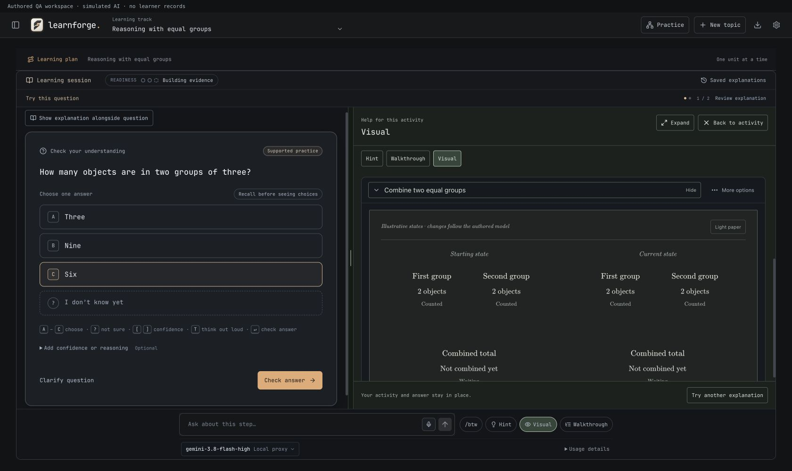
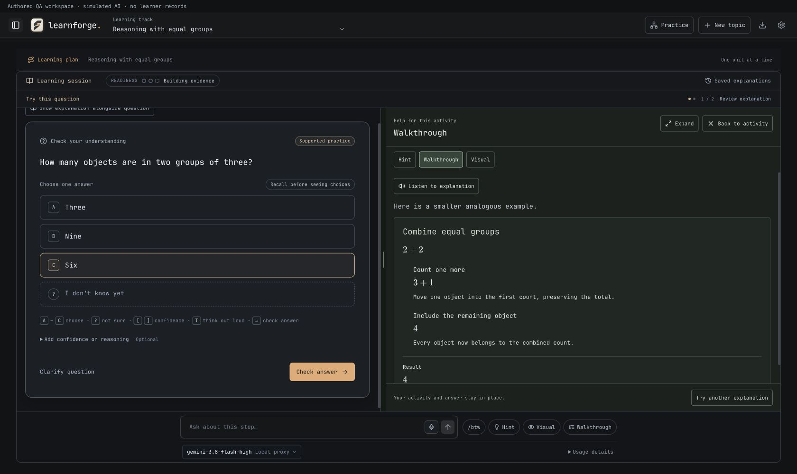
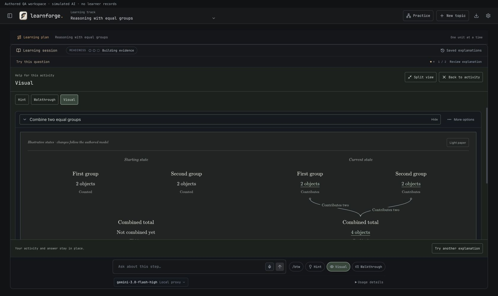

# Learning help layout — 2 November 2026

## Design choice and correction

A comfortable reading measure helps long prose, but it should not constrain an entire workspace containing an activity and a visual explanation. The previous lesson-only shell stopped at 1,080px and the help pane at 560px, leaving large unused margins while compressing figures and walkthroughs.

Opening learning help now lets the lesson-only workspace fill the available area. Prose retains a roughly 70-character reading measure inside the pane; figures, code and worked layouts can use its full width. At a 1,680px viewport with the roadmap hidden, the stage measured 1,610px and the default visual pane approximately 895px.

## Behavior

- Hint, walkthrough and visual start with different proportions: 42%, 52% and 56% of the available split respectively. The layout retains at least 400px for help and 420px for the activity when split view is viable.
- Drag the divider, or focus it and use Left/Right arrows. Home/End reach the permitted limits; double-click restores that help kind's default. Widths are remembered independently in `learnforge:help-layout`.
- **Expand** gives help the full stage. **Split view** brings the activity back. Neither action remounts the activity or figure, submits an answer, requests new teaching, or advances a lesson.
- Below a 960px stage, help uses the full available panel rather than compressing two columns. Back to activity or Escape restores the original activity and focus.
- The centered reading layout remains when help is closed. Coding practice continues to own its separate editor space when explicitly open.

## Verification

- **454 tests passed across 64 files.** Six new sizing/persistence tests cover large screens, pane bounds, keyboard limits, hidden/narrow stages, separate help preferences, malformed storage and unavailable storage.
- TypeScript and the production Tauri build passed. Existing bundle-size warnings remain.
- Browser checks used the production App with authored content and a simulated provider on a separate localhost origin. Verified wide layouts with the roadmap shown/hidden; pointer drag; keyboard resizing; double-click reset; independent help-kind sizes; width and selected-answer restoration after reload; expansion and return with the explored figure state and original answer intact.
- At 980px, help occupied the full 934px stage without a divider. At 390px, help was 366px wide and document width stayed at 390px. Escape restored the selected answer, removed the activity's inert state, and returned focus to the help trigger.
- The app was ad-hoc signed, passed `codesign --verify --deep --strict`, and was installed at `/Applications/LearnForge.app`. All four installed file hashes matched the signed bundle. Backup: `.lazyweb/install-backups/before-typeset-figures-c2e27ae37f/LearnForge.app`. The running app was left open; reopen to use the update.

