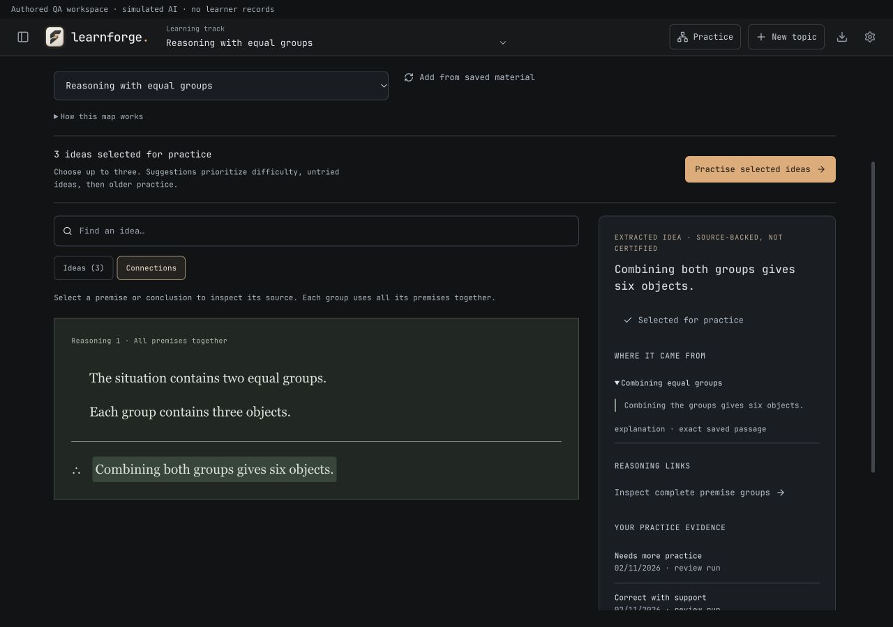
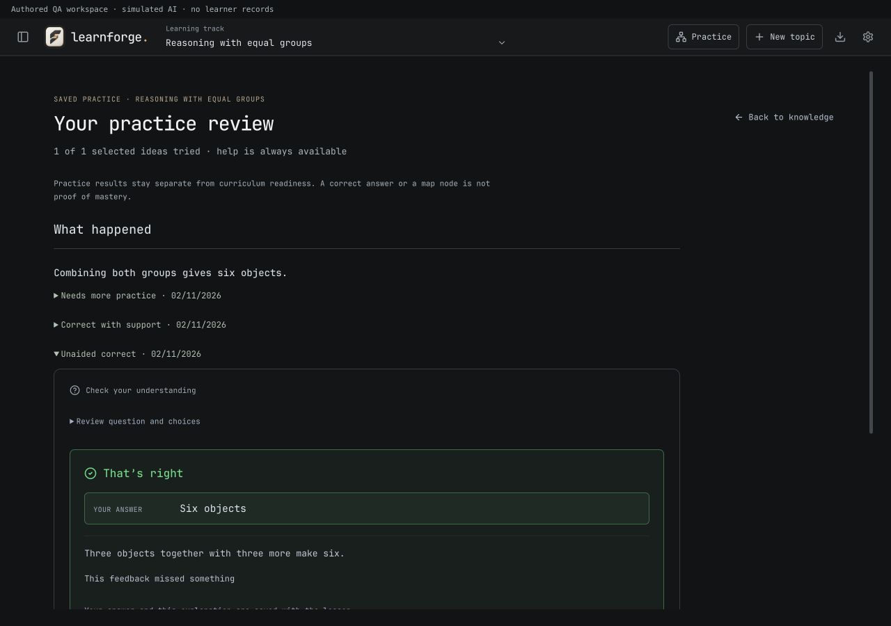

# Knowledge and practice verification — 2 November 2026

## What changed

The header now opens **Knowledge & practice**. Choose a topic and explicitly build a map from its saved lessons, explanations and uploaded-source excerpts. Ideas carry exact saved quotations; the connection view keeps jointly necessary premises together in a paper-style inference. This is a reasoning/source graph, not a second curriculum or a certification of factual truth.

Select one to three ideas for a saved practice run. Questions reuse the existing pre-answer review and written-response grading. Original answers, retries, tutoring and disputes persist. Hint, worked-example, visual and source help preserve the pending question and count as support. Earlier answers remain inspectable during the run; opening them also counts as support. Continue is explicit. A smaller guided case can lead back to an unaided question or a changed situation.

Recommendations prioritize recent difficulty or unresolved feedback, then untried ideas, supported success and older unaided applications. They do not claim calibrated mastery or run a new spaced-repetition algorithm. Practice results do not unlock curriculum milestones.

## Persistence and ownership

Maps use `learnforge:knowledge:<encoded-topic>`. Each run uses its own `learnforge:practice:<encoded-topic>:<run>` record and a snapshot of the material. Updating the map preserves previous exact identities and complete premise groups; it does not semantically merge statements or prune older evidence. Deleting a topic removes owned maps, runs, question drafts, help markers and review caches. Other topics are preserved.

Records are validated on hydration. Malformed records are skipped without being silently overwritten. Quota and provider failures are visible. Map generation has a 35-second deadline; practice preparation has a 30-second deadline. Cancellation retains committed work.

## Verification

- Frontend: 440 tests across 62 files passed, including quote anchoring, joint-premise preservation, cycles/dangling links, topic isolation/deletion, snapshot independence, duplicate submissions, supported vs unaided outcomes, review-receipt binding, disputed results after reload, damaged-record hydration and unavailable coach routes.
- Production TypeScript/Vite build passed. Existing bundle-size warnings remain.
- Browser verification uses the real App/components with an authored topic and a simulated provider on a separate localhost origin. It does not use learner records or call an external model. Screenshots carry an authored-QA label.

Browser checks passed at 1280 × 900 and 390 × 844: building and reloading a map; inspecting a complete two-premise relation and source quotes; selecting one idea; wrong answer → retry → held tutoring; guided correct vs unaided correct outcomes; an unsubmitted selected choice restored after reload; duplicate question rejection preserving the prior result; cancellation and retry; visual help preserving the current question; earlier-answer disclosures; end-of-run review; disputes remaining unresolved after reload. Both viewport checks reported no horizontal overflow. Provider responses were authored, so this checks UI and state behavior rather than model teaching quality.

Final verification: `npm test` passed 440 tests across 62 files; `npm run tauri -- build --bundles app` completed with the final typography rule verified in the emitted CSS. The bundled app was ad-hoc signed and passed `codesign --verify --deep --strict`.

Installed at `/Applications/LearnForge.app`, with all four bundle file hashes matching the signed source. The previous app is backed up at `.lazyweb/install-backups/before-typeset-figures-9a2212aa07/LearnForge.app`. The running Mac process was left open to preserve the current session; reopening loads the installed build. No GitHub release asset was published by this work.

Keyboard verification also confirmed Escape closes practice help and restores focus to its trigger. A run can end with an unanswered question recorded as unanswered, without generating tutoring or awarding credit.

## Limits

Exact quotations establish provenance, not entailment or truth. The model can still propose an inaccurate interpretation or an inappropriate question even after structural validation and question review. Exact statement identity avoids destructive semantic merging but may leave paraphrases as separate ideas. The map is updated explicitly rather than after every answer. Practice supports choice and rubric-based written responses; it does not yet include every optional editor/prediction tool from the lesson flow. There has been no matched learner evaluation establishing better teaching or retention than LearnHarness.
