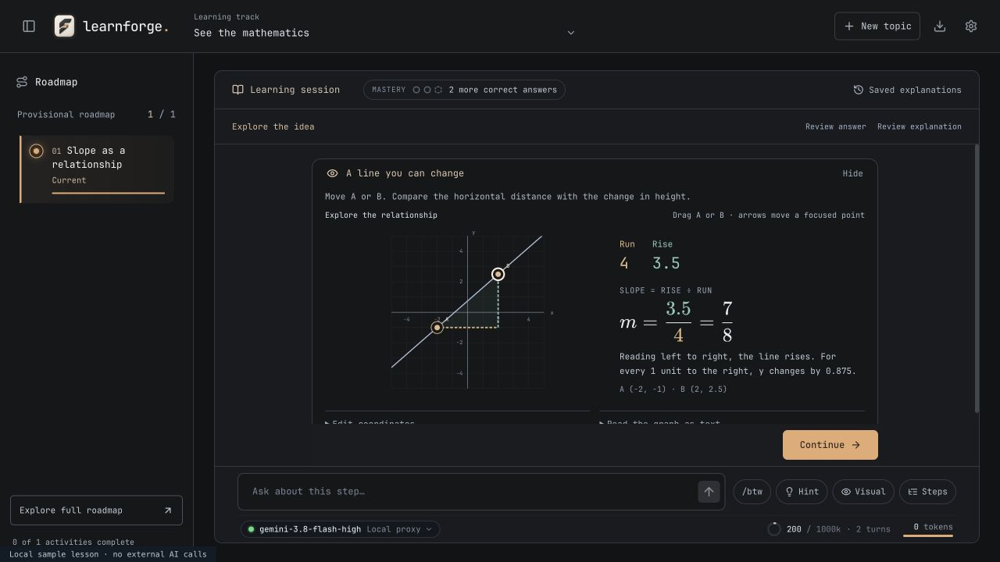
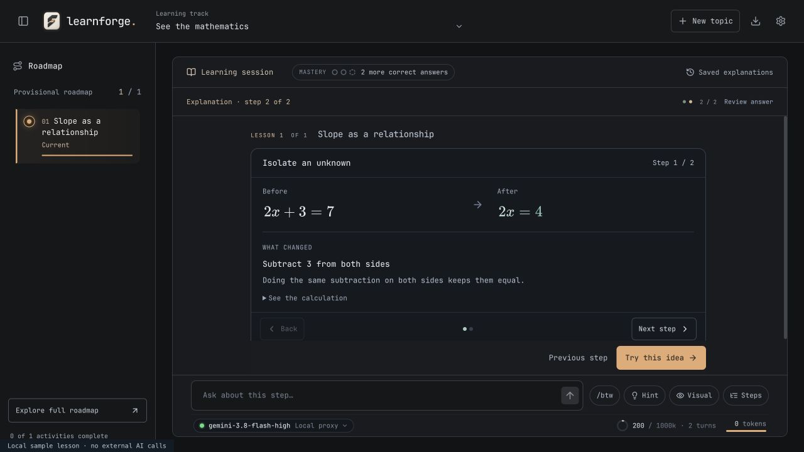

# Mathematical visual learning

28 October 2026 — implemented first release.

## Product decision

Use the existing KaTeX renderer for mathematical notation, owned React/SVG controls for interaction, and the existing focused lesson flow for pacing. The aim is to connect an expression to an observable change, while explaining that change in everyday language. Typographical polish by itself does not establish mathematical correctness or learning gains.

This is subject-specific presentation, not a fixed "visual learner" category. Mathematical models belong in relevant mathematics, science or programming explanations. A language lesson should retain phrases, exchanges and subject-appropriate illustrations. The tutor instructions preserve the actual goal and presentation preferences; they do not insert the sample algebra lesson into other topics.

## Research translated into features

| Primary source | Finding/capability | Design decision |
| --- | --- | --- |
| [IES practice guide: Organizing Instruction and Study](https://ies.ed.gov/ncee/wwc/PracticeGuide/1) | Recommends pairing graphics with verbal explanations, connecting abstract/concrete representations, and alternating worked examples with independent problems. | Show a graph and its changing equation together. Explain each transformation, then return to a different applied question. These recommendations support the approach; the exact LearnForge UI has not been evaluated with learners. |
| [KaTeX supported notation](https://katex.org/docs/supported) and [rendering options](https://katex.org/docs/options) | Mathematical typesetting includes fractions, aligned expressions and annotations; HTML plus MathML supports visual and accessible representations. | Reuse KaTeX, preserve its mathematical typeface, and connect consistent colors to explicit text labels. Keep JetBrains Mono for interface controls. |
| [W3C guidance for complex images](https://www.w3.org/WAI/tutorials/images/complex/) | Graphs need concise identification plus an equivalent explanation of their essential information. | Give the graph a title, current coordinates, changing measurements, and an expandable text description. Add keyboard and numeric-input alternatives to dragging. |
| [KaTeX security guidance](https://katex.org/docs/security) | Trust and expansion/size controls matter for untrusted TeX. | Share `trust: false`, bounded expansion and size across prose, ladders and graph equations. Render invalid notation as a readable escaped fallback in the new formula component. |

## Guided derivations

Existing mathematical `ladder` blocks now show one transformation at a time:

- The expression before and after one operation.
- The operation and a plain explanation of why it is valid (`rule:` and optional `why:`).
- An optional intermediate calculation, collapsed until requested.
- Back / Next step controls, reset and an optional all-steps reference.
- A final result appears when the last transformation is reached. Future transformations are not mounted in the default view.

Non-mathematical ladders retain their existing state-trace presentation. Existing saved mathematical ladders render through the new presentation automatically. Parsers accept at most 12 steps and bound their text; model instructions ask for one operation per step and preservation of equality/units. KaTeX typesets what the tutor writes; it does not verify algebraic truth.

The example used for local QA solves an analogous equation with two operations. It is an ignored test fixture, not a new hardcoded topic or learner curriculum.

## Interactive slope graph

The new `forge-visual` variant uses structured data:

```json
{
  "kind": "graph",
  "title": "A line you can change",
  "summary": "Move either point and compare rise with run.",
  "graph": {
    "type": "slope",
    "points": [{ "x": -2, "y": -1 }, { "x": 2, "y": 3 }]
  },
  "items": [
    { "id": "run", "label": "Run", "description": "Horizontal change from A to B." },
    { "id": "rise", "label": "Rise", "description": "Vertical change from A to B." }
  ],
  "takeaway": "Slope compares vertical change with horizontal change."
}
```

The points are supplied by the tutor for the current concept, rather than fixed as a learner roadmap. Only the owned `slope` model is accepted. Coordinates must be finite, within −5 to 5, and multiples of 0.5. Descriptors cannot supply executable functions, scripts or arbitrary graph expressions.

Learners can drag A or B, tab to a point and use arrow keys, or enter coordinates. The line, rise/run triangle, measurements, reduced fraction and text interpretation change together. Horizontal lines have slope zero; vertical lines have undefined slope; coincident points do not define a unique line. Reset returns to the supplied starting points. The numerical model computes the result locally without an execution API or AI request.

Graphs open as a focused activity from both the Visual action and the question's Inspect visual button. The primary question action remains visible. Returning preserves the selected answer. Viewing or manipulating a graph for a pending question records support through the existing practice-support mechanism; this interaction is never independent mastery evidence. The tutor is instructed to choose analogous points rather than solving the pending question.

## Validation

- 215 automated tests across 33 files passed. New coverage checks validation bounds, exact signed fractions, point reversal, horizontal/vertical/coincident cases, formula fallbacks, progressive reveal and intact display equations across slides.
- Local browser QA used a disposable sample lesson and blocked external AI calls. It checked pointer dragging (slope changed from 1 to 1/2), keyboard movement (1 to 7/8), coordinate editing, vertical/coincident states and reset.
- A selected answer remained selected after visiting the graph. Submitting showed supported-practice feedback and waited for Continue; mastery did not increase from using the graph.
- At a 350px container width, both cards and the equations had no horizontal content overflow. Advanced coordinate/text panels and long formulas may still require local scrolling when opened.
- Mathematical ladder navigation was verified in the actual session, including the final result and earlier transformations. Optional all-steps view intentionally permits a longer reference.
- A macOS Tauri bundle was built. The running user app was not restarted, and no user topic or learning state was changed.

## Deliberate scope and next work

This release supports an interactive **straight-line slope model**, not a general graphing calculator, symbolic solver, calculus engine, arbitrary LaTeX compiler or TikZ runtime. No paid API, native TeX installation or new rendering service is required. Graph and derivation position changes are exploratory component state, not durable assessment answers; reopening/remounting may reset them.

Good follow-ons are quadratic/derivative models with the same bounded data contract, geometric measurements and probability regions. Add these when an actual learning task needs their controls. TikZ-to-SVG can be considered for specialized static scientific diagrams, with a separate isolated compilation service; it has not been implemented. A moderated learner study is still required to establish whether these interactions improve understanding and delayed recall.

## Screenshots

The screenshots use disposable local sample content, not a real learner's answers.




