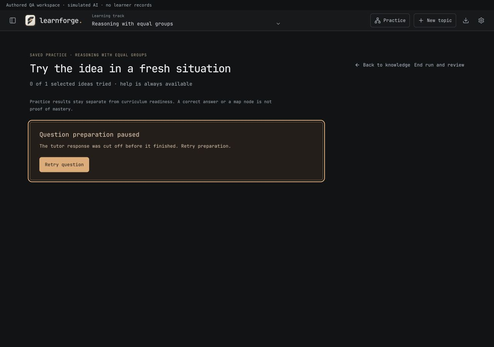
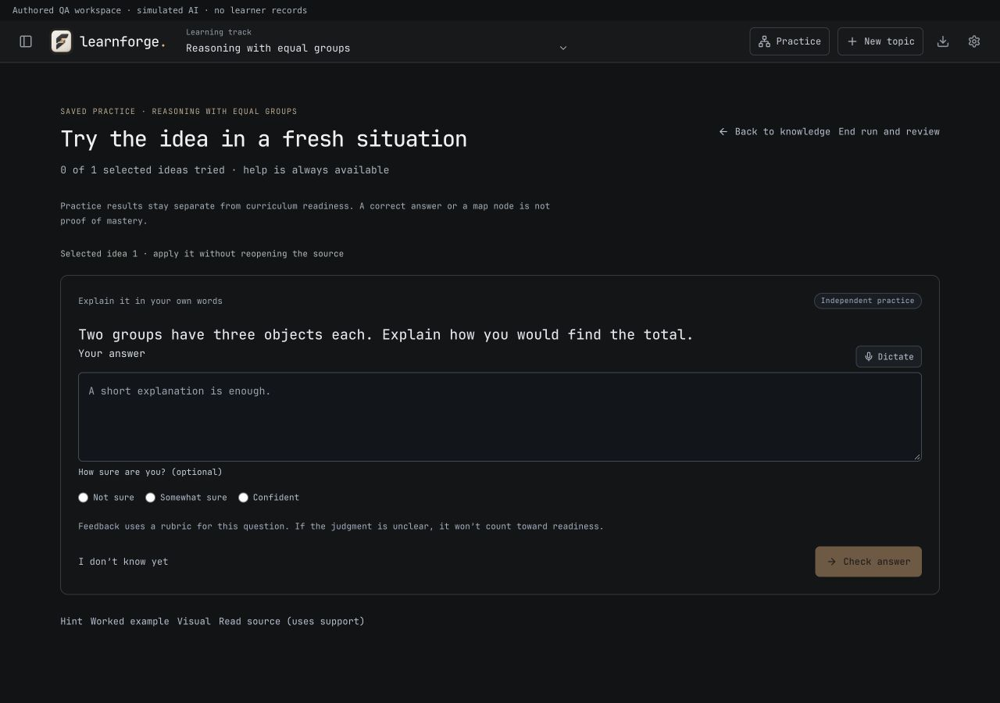
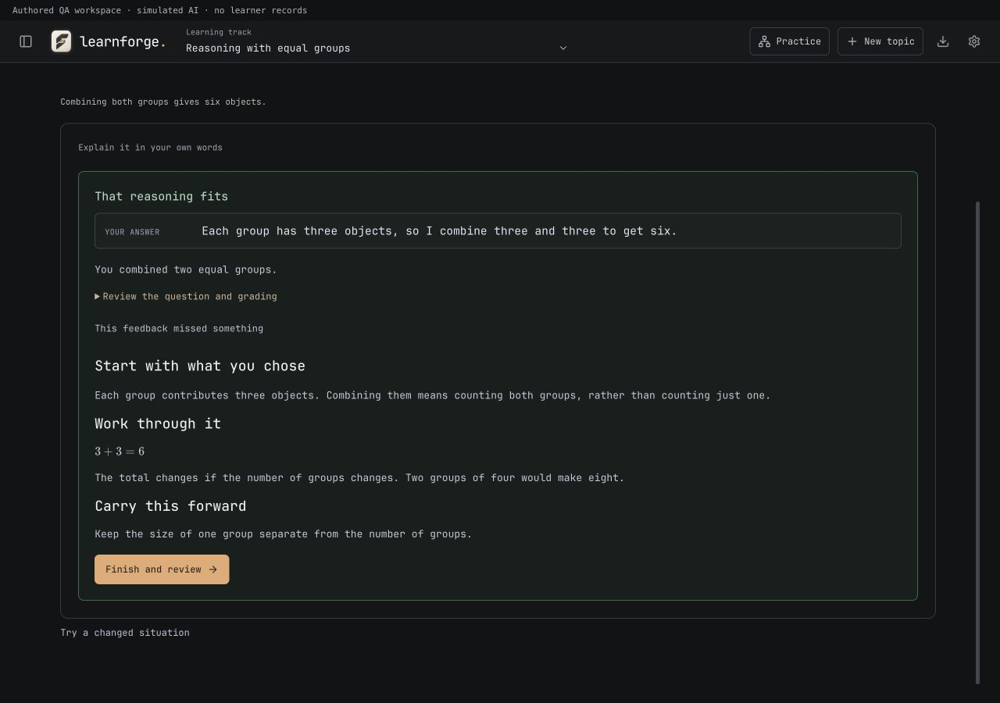

# Practice loading recovery — 2 November 2026

## Reproduced cause

A request through the app's default localhost AI proxy returned HTTP 200, `finish_reason: stop`, and a complete, valid written-response question inside a `forge-check` Markdown fence. The practice loader only stripped plain/`json` fences, so JSON parsing rejected the otherwise usable question. The shared free-response instructions had encouraged that wrapper. This reproduction used a small authored language-comparison example, not saved learner material.

## Change

Practice now accepts complete plain JSON, `json` fences, and the existing `forge-check` question protocol. Text content blocks are decoded while reasoning blocks remain excluded. Written and choice question schemas are explicit in the generation request, with no competing outer-wrapper instruction.

Empty, malformed, truncated and refused replies have distinct errors. No missing answer keys or rubric fields are fabricated, and surrounding prose is not searched for a convenient JSON object. The existing schema validation and independent question-review gate remain in place.

A failed question preparation now focuses and reveals an error with a direct **Retry question** button. Retrying preserves the target, practice mode, saved run and previous work. There is no automatic retry loop. Ending a run clears its pending retry action.

## Verification

- Replayed the original live-provider response through the fixed production generator: accepted as a written-response question with both original rubric criteria preserved.
- One fresh request through the same default local proxy: HTTP 200, complete valid choice question. This is generation/transport verification, not a learning-outcome study.
- **448 tests passed across 63 files**, including eight new provider-response regressions covering plain/fenced JSON, typed text, reasoning exclusion, invalid/incomplete responses, committed rubric validation, nested Markdown/notation and cancellation.
- TypeScript and the production Tauri build passed. Existing bundle-size warnings remain.
- Production App browser fixture: a deliberately truncated first reply showed the focused recovery panel; Retry accepted a valid `forge-check` written question; question review approved it; a submitted written answer was graded and saved; tutoring remained visible until explicit Continue. The fixture uses authored responses on an isolated localhost origin.
- Desktop check at 1280 × 900. Compact check at 390 × 844: document width 390px and practice content width equalled its client width, with no horizontal overflow.
- Ad-hoc signature verified with `codesign --verify --deep --strict`. Installed `/Applications/LearnForge.app`, with all four file hashes matching the signed bundle. Backup: `.lazyweb/install-backups/before-typeset-figures-8793d7215c/LearnForge.app`. The running app was left open; reopen to load the fix.

