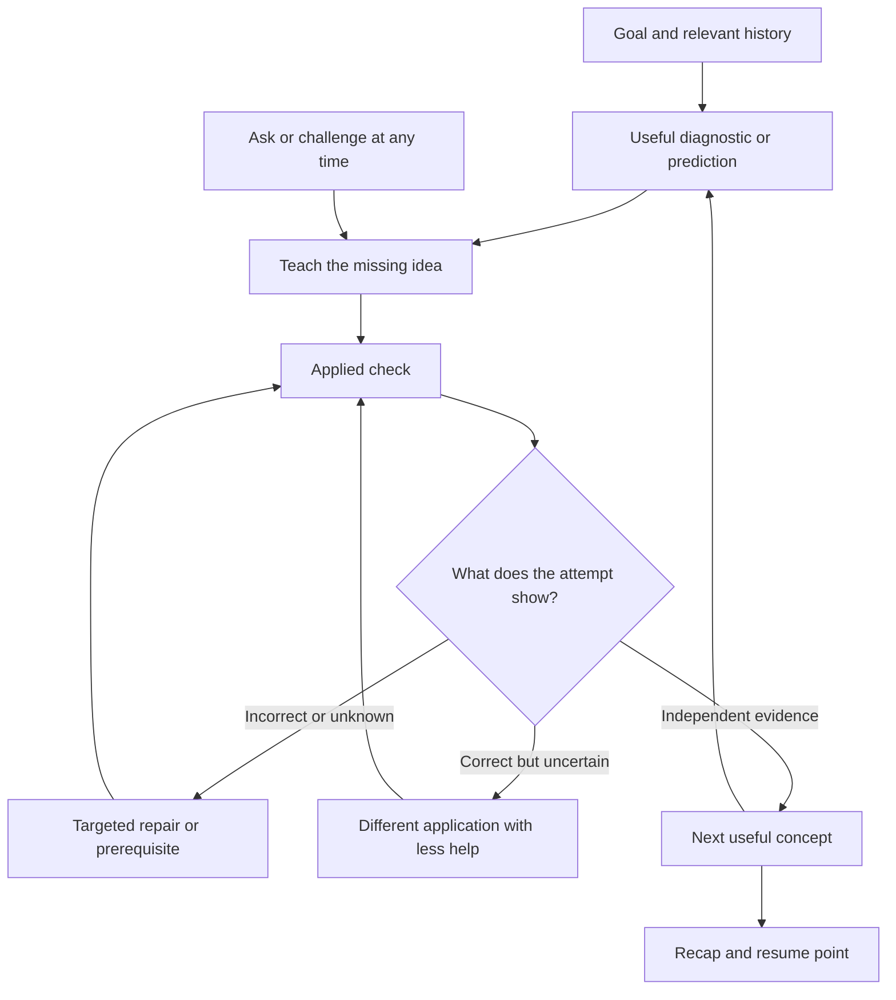
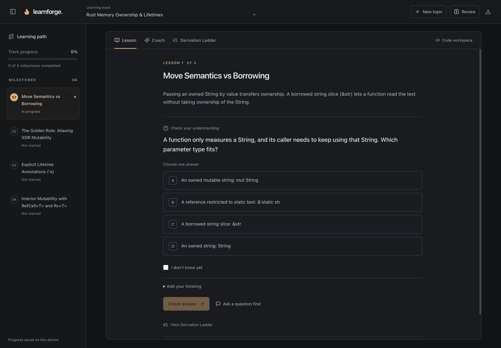
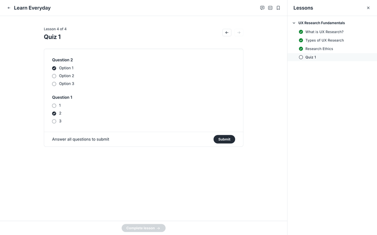
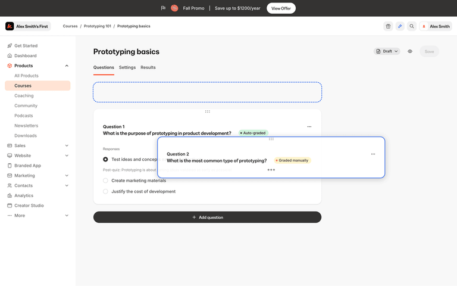
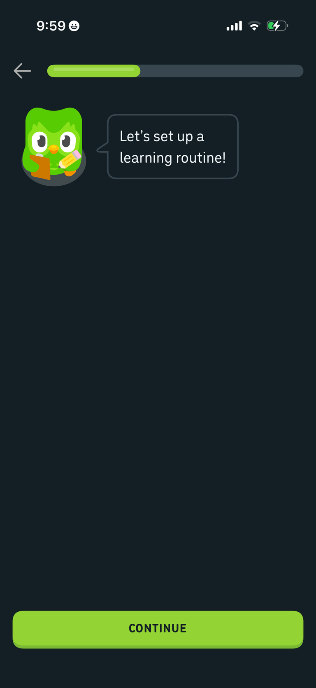
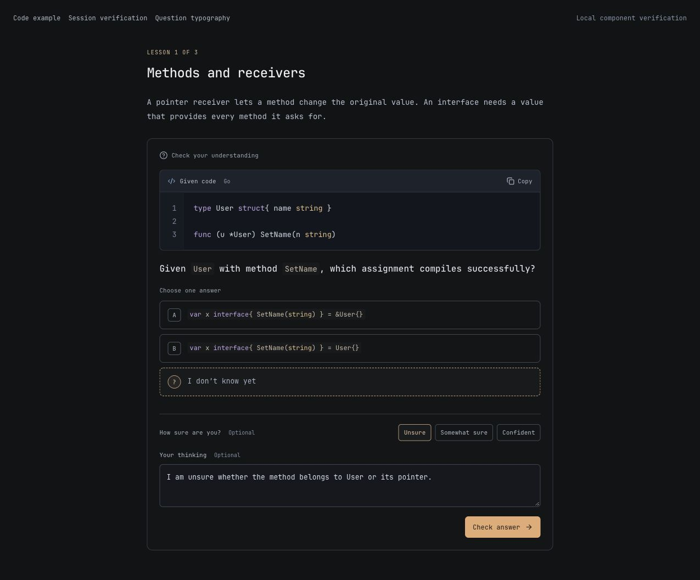
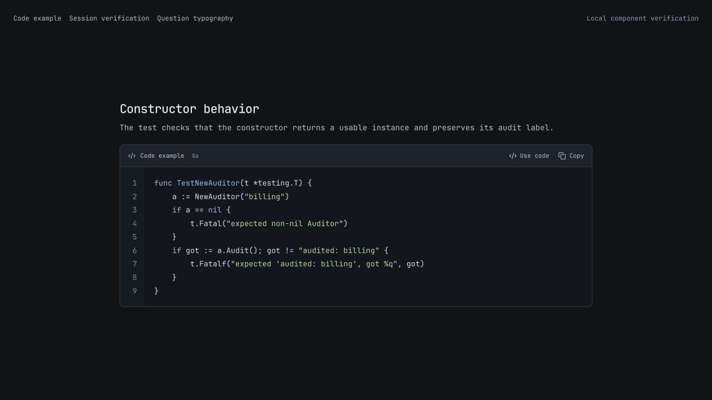
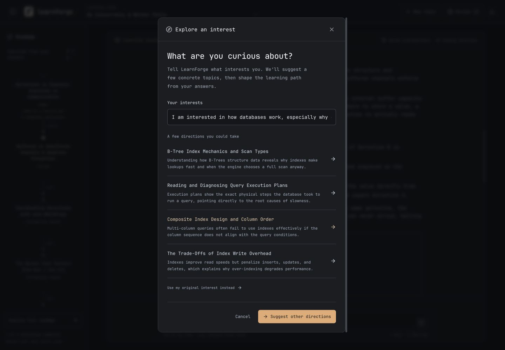
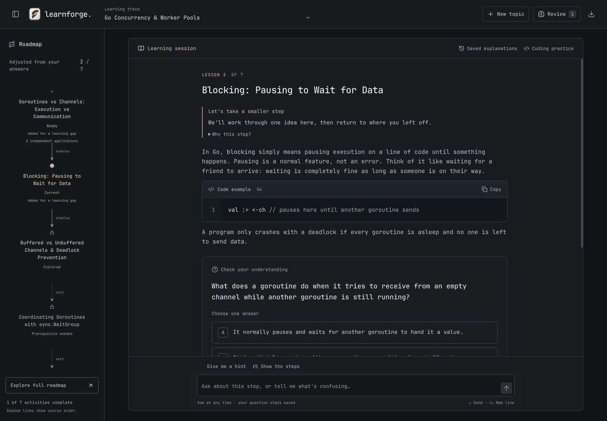
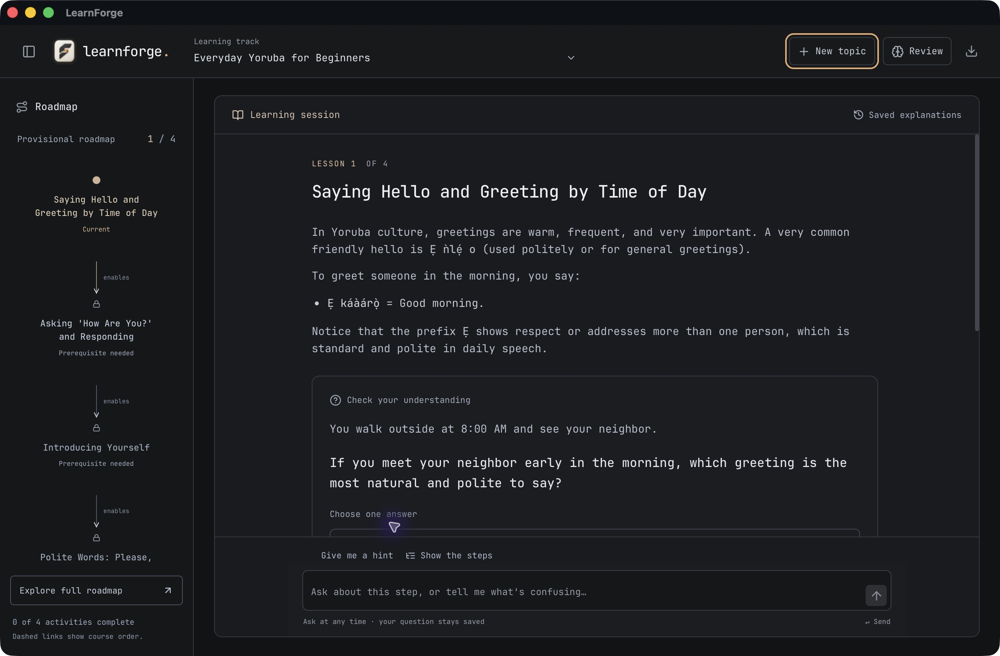

# LearnForge: product design and learning experience research

Research started: 26 October 2026 · Updated: 27 October 2026  
Status: evidence review and proposed experience. This is **not** a claim that the adaptive experience below is already implemented or user-validated.

## Recommendation

Build a guided learning session around the learner’s goal and observed understanding. The tutor should select the next useful activity, explain that choice briefly when it changes direction, and let the learner interrupt at any point.

The primary experience should be one continuous session. Explanations, questions, derivations, and optional coding are activities inside it. Making the learner choose among Lesson, Coach, Derivation Ladder, and Code asks them to do the instructional planning that the product should handle.

The initial question-first prototype was a useful component, but not a complete product experience. Multiple-choice questions alone do not make learning adaptive. A correct selection alone does not establish mastery.

## 1. What problem are we solving?

Working audience hypothesis: a technically curious adult trying to understand a difficult idea well enough to reason with it. This comes from the existing engineering tracks and this user’s feedback; it has not been validated across a wider audience.

**Job:** “Help me understand this topic, notice where my reasoning breaks, and guide me to the next useful step without making me manage a collection of tools.”

A successful session should leave the learner able to apply an idea to a different case, explain the relevant invariant, and resume later without reconstructing the context. Finishing screens, generating text, and filling a progress bar are insufficient evidence.

### Observed problems in LearnForge

| Evidence from the user and source                                                                | Experience consequence                                                               | Product response                                                                         |
| ------------------------------------------------------------------------------------------------ | ------------------------------------------------------------------------------------ | ---------------------------------------------------------------------------------------- |
| The user calls the experience busy, confusing, and insufficiently agentic.                       | Improving individual panels does not resolve the missing learning arc.               | Design the session lifecycle before another visual pass.                                 |
| The learner must choose Lesson, Coach, Ladder, and Code.                                         | The learner decides both what to learn and which tool should teach it.               | Present the next activity in the same session; keep tools secondary.                     |
| Starter tracks appear as permanent personal topics.                                              | The app feels like a demonstration catalog rather than a workspace the learner owns. | Separate optional starter courses from personal topics; support removal and restoration. |
| The original app opens an editor for every lesson.                                               | Reading, reasoning, and conceptual learning inherit coding overhead.                 | Open coding practice only when requested or useful to the objective.                     |
| The first interactive prototype marks a lesson completed after one correct answer.               | Recognition or guessing can be mistaken for understanding.                           | Separate answer correctness, activity completion, and evidence of understanding.         |
| New questions require a manual generation request; grading is not automatically a tutoring turn. | The learner must drive the tutor after every answer.                                 | Answer submission should feed the next teaching decision.                                |
| Derivations existed in chat but became hard to find.                                             | A useful explanation feels lost when navigation changes.                             | Render it in context and retain a saved explanation entry point.                         |
| An arithmetic example was added to a systems lesson as a style demonstration.                    | The app teaches unrelated content and loses credibility.                             | Use the current topic for every explanation; keep visual fixtures outside the product.   |

## 2. Method and evidence limits

Reviewed LearnForge source and its running desktop UI; inspected the local LearnHarness repository without modifying it; read primary product descriptions, a current product experimentation report, learning-engineering guidance, human–AI interaction research, and accessibility/motion guidance. Searched Lazyweb through six angles, including desktop question feedback, learning entry points, adaptive practice, and targeted competitor references.

This is desk research and a source audit, not a usability study. Product descriptions establish intended behavior, not independent proof of effectiveness. Screenshot references establish visible layout patterns, not adaptation logic. Claims in local product doctrine are design decisions, not general scientific laws. Proposed timing values and acceptance thresholds below are design targets to test.

## 3. What the references actually teach us

### LearnHarness: the important part is the learning loop

The local repo uses distinct assessment and teaching responsibilities behind one conversation. Its diagnostic questions use the learner’s answer, reasoning, and confidence to locate their understanding. Teaching distinguishes a prediction before an explanation from an application check afterward. Its question contract validates answer keys and stable option values, persists pending questions, and returns graded results to the agent.

The most relevant correction is that its design explicitly abandons “one correct check means the node is done.” Position in a plan and completion are separate concepts. This is stronger than merely copying its question card.

Local evidence:

- [Probe and teaching design](../../learnharness/docs/probe-teach-split.md)
- [Probe doctrine](../../learnharness/src/agent/prompts/prober/10-probe-doctrine.md)
- [Prediction and check cycle](../../learnharness/src/agent/prompts/teacher/28-predictions.md)
- [Applied-question principles](../../learnharness/src/agent/prompts/teacher/30-question-principles.md)
- [Question tools and reasoning channels](../../learnharness/src/agent/prompts/shared/20-question-tools.md)
- [Question validation and grading](../../learnharness/src/core/question-core.ts)
- [Question dock](../../learnharness/components/question-dock.tsx)

**Apply:** one conversation, diagnostic distractors, durable answers, and an explicit answer-to-tutor continuation. Do not import its graph, lengthy assessment process, or implementation wholesale. References were inspected; the new LearnForge question implementation was written independently.

### Brilliant: content, feedback, and tutoring share context

Brilliant describes a tutor aware of the current activity, visual interaction, targeted practice, and gradually reduced assistance. Its approach distinguishes supported learning from independent practice, and uses increasingly demanding applications of a concept. It also describes trying a problem before instruction in some learning sequences. These are product claims, not proof that every LearnForge lesson should follow the same sequence. [Brilliant’s method](https://brilliant.org/about/)

**Apply:** a ladder should appear because a state transition needs explaining. A visual model should allow a relevant prediction or manipulation when possible. Avoid a separate destination whose main action is “generate a diagram.”

### Khan Academy: useful learner context matters more than a transcript dump

Khan Academy’s May 2026 report evaluates tutoring through response time, independent correctness on the next problem, and cognitive engagement. It reports benefits from recent attempt summaries and prerequisite information, while providing the full current-session log alone did not initially improve performance. It also tracks premature answer disclosure as a guardrail. The reported experiments concern Khanmigo’s context and population; their numerical effects cannot be assumed for LearnForge. [Khan Academy’s product experiments](https://blog.khanacademy.org/how-khan-academy-is-building-a-better-ai-tutor-our-most-recent-learnings/)

**Apply:** give the tutor a compact record of relevant attempts, assistance used, and unresolved confusion. Measure the next independent application. More chat history and more generated prose are not sufficient personalization.

### Duolingo: the next activity is part of the product

Duolingo describes personalization as selecting exercises within a designed course structure using learner performance. Its learning guidance integrates review and mistake practice into the course. That suggests a useful division: maintain a coherent objective and prerequisites while adapting activity selection. This does not establish that Duolingo’s pacing or gamification should be copied for technical adults. [Exercise personalization](https://blog.duolingo.com/how-duolingo-experts-work-with-ai/), [learning and review flow](https://blog.duolingo.com/duolingo-101-how-to-learn-a-language-on-duolingo/)

**Apply:** offer a clear next step and an intelligible reason, rather than an open-ended menu of teaching tools. Let the learner change pace and skip with an honest record of what remains unverified.

### Carnegie Mellon: understanding is inferred from evidence

CMU’s learning-engineering guidance models skills through observable attempts, errors, and help requests. It cautions that learning itself is not directly observable and that high-level grades can hide which skills changed. Repeated independent application is more informative than a single completed activity. [CMU DataLab: key concepts](https://www.cmu.edu/datalab/getting-started/key-concepts.html)

**Apply:** keep progress claims modest. “Applied independently twice” describes evidence; “mastered” after one multiple-choice selection overstates it. Confidence informs a follow-up but is neither a grade nor a diagnosis by itself.

### Human–AI interaction: initiative needs control and repair

Microsoft’s guidelines recommend contextually timed assistance, memory of recent interactions, explanations of system behavior, efficient dismissal, and recovery from mistakes. Apple’s 2026 research on computer-use agents examines related concerns around explainability, control, and mental models. Its domain differs from tutoring, so it informs interaction principles rather than educational outcomes. [Microsoft HAX guidelines](https://www.microsoft.com/en-us/research/blog/guidelines-for-human-ai-interaction-design/), [Apple’s agent UX research](https://machinelearning.apple.com/research/mapping)

**Apply:** adaptive does not mean uncontrollable. The learner can stop, question the grading, ask for a different explanation, change the goal, or leave without losing the current activity.

## 4. The proposed experience

### A. Enter through a real goal

A new workspace starts with “What do you want to understand?” and an input. Optional starter courses are a secondary route. An existing workspace leads with “Continue” for the most recent session, accompanied by a short recap of the unresolved idea.

If the goal is broad, ask one clarifying question whose answer changes the teaching. Do not require a level survey, duration picker, preference questionnaire, and lengthy curriculum approval before useful work begins. Assess knowledge with a relevant problem rather than trusting a self-selected Beginner label.

### B. One guided session

1. Establish the goal and use existing evidence where available.
2. Ask a relevant diagnostic or prediction when it will reveal something useful.
3. Explain the smallest missing idea, grounded in the learner’s response.
4. Offer an applied check on a new case.
5. Use the response to repair, consolidate, or extend the idea.
6. Close with an evidence-based recap and a resumable next step.

This is a flexible teaching loop, not a mandatory six-screen wizard. A novice may need a brief explanation before a meaningful attempt. An experienced learner may move directly to a difficult application. A direct question deserves a direct answer; do not enforce an endless Socratic interrogation.



### C. One main surface, with contextual tools

```text
← Your topics           Raft elections             Session history · More

Why a timeout does not make a leader
One sentence connecting this activity to your goal.

Tutor explanation, question, or interactive model
Only one question is waiting for an answer.

[ answer choices ]
[ I don’t know yet ]   [ optional reasoning / confidence ]

[ Check answer ]

Ask about this step…                                      [Send]
```

The composer remains available. The current question remains visible and retains its draft during clarification. Earlier completed turns can collapse into readable summaries, with expansion for the full record. Do not create a second indefinite chat history beside an indefinite lesson history.

A derivation is embedded at the relevant turn. A saved-explanations control retrieves prior ladders. Code opens as optional practice beside the session on a wide screen and as a temporary surface on a narrow one. Closing it preserves the draft and returns to the same activity.

NN/g’s progressive disclosure guidance supports deferring occasional tools while keeping frequent task actions visible. Which actions belong in the primary surface still needs observation of actual use. [Progressive disclosure](https://www.nngroup.com/articles/progressive-disclosure/)

### D. The next step depends on the attempt

These are proposed policies to validate, not a statistical mastery model:

| Observation                                                 | Tutor’s next action                                                           | Learner-facing reason                                   |
| ----------------------------------------------------------- | ----------------------------------------------------------------------------- | ------------------------------------------------------- |
| Wrong with reasoning that suggests a specific misconception | Contrast that model with a small counterexample, then a fresh check.          | “Let’s separate starting an election from winning one.” |
| Wrong with no reasoning                                     | Ask a focused diagnostic or give a small hint; do not invent a misconception. | “Let’s first check what a term change tells us.”        |
| Correct with low confidence                                 | Use a different application with less scaffolding.                            | “You got it. Let’s make sure it holds in a new case.”   |
| Correct after a hint                                        | Record supported success, then verify independently.                          | “Now try the same idea without the hint.”               |
| Correct with sound reasoning across different cases         | Advance or offer a harder extension.                                          | “You’ve applied that distinction in two situations.”    |
| Unknown                                                     | Teach a prerequisite or simpler concrete example.                             | “Start with what one server can know locally.”          |
| Grading challenged                                          | Retain the attempt, review the question and key, allow correction.            | “Let’s check whether the wording permits your answer.”  |
| Learner changes the goal                                    | Update the visible objective and next activity; preserve the record.          | “We’ll focus on failure recovery instead.”              |

Answer correctness should be deterministic when there is a committed choice key. The tutor interprets the pedagogical significance. It must not rewrite the answer key to make its continuation look correct.

## 5. A concrete Raft journey

**Goal:** understand why Raft avoids two leaders in the same term.

**Prediction:** a follower times out. Is it already leader? The learner selects “yes” and says they are confident.

**Response:** identify the distinction between a local timeout and a majority vote. Show the follower → candidate transition as a small ladder. Ask the learner what information the timeout actually provides. Do not launch a separate Ladder mode.

**New application:** two followers time out close together. Ask what prevents either from assuming leadership solely from its timeout. Use plausible competing models as choices. Explain the governing rule after submission.

**If correct but uncertain:** offer a different vote-count scenario. **If wrong:** repair the majority/quorum prerequisite. **If independently correct:** advance to a later term or partition case. A single selected option does not mark the whole elections topic mastered.

**Close:** recap the distinction the learner demonstrated, what still needs practice, and where to resume. Schedule a later retrieval activity from the actual concept, not a generic code card.

## 6. Microinteractions that support the experience

Motion should explain state and preserve continuity. Carbon distinguishes restrained task motion from occasional expressive motion; Material’s current motion guidance also distinguishes a functional standard scheme from more expressive behavior. LearnForge should choose the functional end of those systems. Exact durations below are proposed web tokens, not universal standards. [Carbon motion](https://carbondesignsystem.com/guidelines/motion/overview/), [Material motion](https://m3.material.io/styles/motion)

| Moment                           | Proposed behavior                                                                                                    | Avoid                                                                        |
| -------------------------------- | -------------------------------------------------------------------------------------------------------------------- | ---------------------------------------------------------------------------- |
| Choose an option                 | Immediate selected border and check state; 100–140 ms color transition. Selection remains editable until submission. | Auto-submitting when a radio is selected; moving options mid-question.       |
| Submit                           | Commit once, preserve the chosen answer, show correctness promptly, then stream the targeted explanation.            | Clearing the question, double submissions, fake progress percentages.        |
| Tutor prepares the next activity | Plain status describing the actual operation and a working Stop control.                                             | Fabricated tool activity, indefinite shimmer, animated “thinking” theatrics. |
| Feedback arrives                 | Keep the answered card’s position, reveal feedback below it, announce concise status accessibly.                     | Full-screen transition or forced scrolling while the learner reads.          |
| Advance                          | Brief 140–180 ms content transition after an explicit Continue; focus the new activity heading.                      | Automatically advancing while the learner reads the explanation.             |
| Open a derivation                | Reveal the relevant transition in place, with optional step-by-step controls.                                        | Arrows that keep animating or unrelated example content.                     |
| Remove a topic                   | Permanently delete the topic and its learning data after a clear confirmation (explicit user preference, 2026-10-27).                                                  | Ambiguous removal that secretly archives data, or undeletable bundled content.      |
| Leave and resume                 | Restore the question, option order, reasoning, unsent input, and code draft.                                         | A new AI request that silently replaces unfinished work.                     |

Respect reduced motion, native radio/checkbox keyboard behavior, visible focus, and status announcements. Test that a sticky composer does not obscure the focused question or feedback. Accessibility guidance is an acceptance requirement, not proof of conformance from CSS alone. [W3C focus visibility](https://www.w3.org/WAI/WCAG22/Understanding/focus-not-obscured-minimum.html), [W3C status messages](https://www.w3.org/WAI/WCAG22/Understanding/status-messages.html)

## 7. Visual references and their limits



Current LearnForge: the question card is calmer than the original editor-first screen, but the top-level mode split still makes the learning feel assembled from tools.



Lazyweb desktop reference, Circle, screenshot ID 246152: a multi-question quiz with radio selection, submission, and lesson navigation. It illustrates familiar answer controls, but its batch-quiz layout is not the proposed one-question teaching loop. It does not establish adaptive tutoring.



Lazyweb desktop reference, Kajabi, screenshot ID 241849: a quiz authoring interface with question editing and grading configuration. Visual inspection distinguishes it from a learner-facing quiz. It is a counterexample: course-authoring controls should not shape LearnForge’s focused learning surface.



Lazyweb mobile reference: a single onboarding prompt, progress, back, and Continue. Transfer the focus of one meaningful decision, not the mascot, reward layer, or habit survey. Two of the three selected database references are desktop, matching LearnForge’s main platform.

[Brilliant’s live public method page](design/product-research/brilliant-method.png) was also inspected and captured. It is a public product explanation, not an authenticated lesson walkthrough. Targeted desktop searches for Brilliant and Codecademy did not return exact lesson matches; those results were excluded rather than presented as evidence of a flow we did not observe.

## 8. Implementation gaps and priorities

The current branch has independently implemented validated choice questions, answer drafts, local grading, optional code, and removable/restorable topics. Following this review, the first integrated pass also removes the separate teaching tabs, keeps questions and the composer in one session, sends submitted results into an automatic tutor continuation, and offers advancement after at least two distinct correct applications without recorded help or an “unsure” confidence selection. Earlier explanations remain accessible in saved conversation history.

That threshold is a transparent heuristic, not a validated mastery estimate. The branch does not yet implement the full goal diagnosis, prerequisite model, richer interactive activities, or session recap/retention lifecycle below. Existing completed code exercises and earlier progress are preserved.

| Priority | Needed change                | Acceptance criterion                                                                                                                         |
| -------- | ---------------------------- | -------------------------------------------------------------------------------------------------------------------------------------------- |
| P0       | One session surface          | A learner can learn, answer, ask for help, and view a relevant derivation without switching among teaching modes.                            |
| P0       | Answer-to-tutor continuation | A submitted attempt is durably recorded and supplies the next teaching decision without asking the learner to prompt the coach.              |
| P0       | Honest learning evidence     | A single correct choice does not complete a concept or imply mastery. Supported and independent attempts remain distinguishable.             |
| P0       | User-owned topics            | Fresh workspaces have no imposed personal courses; every added topic can be permanently deleted with its associated learning data.                                            |
| P0       | Interruption and recovery    | Stop, service failure, reload, and topic switching cannot lose an answer, expose an answer key, or overwrite a newer session.                |
| P1       | Compact learner context      | Current goal, recent relevant attempts, help used, and unresolved gaps are supplied to the tutor. Raw history is not the only learner model. |
| P1       | In-context visual reasoning  | A diagram or ladder answers a current question, and remains accessible in session history.                                                   |
| P1       | Session ending and retention | A recap distinguishes demonstrated understanding from unresolved gaps, offers a resume point, and creates relevant review work.              |
| P2       | More interaction types       | Add manipulable state models, ordering, prediction, and short explanation where they measure the objective better than recognition.          |

Do not begin with a large multi-agent backend or a new dashboard. A small, explicit session state machine and validated activity/result events are enough to make the first coherent version testable. AI chooses teaching content; application code enforces pending-question, persistence, cancellation, and grading invariants.

## 9. How to test whether it is better

First compare complete journeys, not isolated screenshots. Observe the owner and a small set of representative technical learners; do not present that convenience sample as statistically generalizable.

Test: start from a broad goal; get an answer wrong confidently; ask a tangent while a question is pending; resume after a reload; challenge an ambiguous question; delete the active topic, reload and verify it stays deleted; finish a session and return later.

Record whether the learner can identify the current objective and next action, whether help reduces confusion, whether they apply the idea to a fresh case without help, where they hesitate or switch tools, and whether they recover from failures. Track service latency and invalid activity rates separately from learning outcomes.

Proposed primary learning measure: correctness on a different, unassisted application after tutoring. Guardrails: answer leakage, unsupported mastery claims, lost drafts, unnecessary repetitions, time waiting, and inability to interrupt. Session length, message count, and Continue clicks are supporting observations rather than success metrics.

## Decision record

**Adopt:** one guided session; learner-owned topics; contextual explanations and ladders; optional code; application questions; visible control; durable attempts; cautious claims about understanding.

**Reject:** another cosmetic-only tab rearrangement; mandatory code editing; unrelated sample lessons; a catalog masquerading as personal topics; automatically declaring mastery after one answer; a tutor that requires the learner to prompt every next step.

**Still to validate:** how much diagnosis is useful before teaching, how often confidence helps without becoming friction, which concepts need visual manipulation, and how much of the learning path should stay visible during focused work.

## Verification of this implementation pass

Automated checks cover question validation, exact-set grading, stable option order, hidden answer keys, persistence-compatible records, topic membership, a single session surface, and conservative advancement evidence. Browser checks use an isolated preview origin so the owner’s main learning history is not used for test answers. Selected answers, reasoning, and confidence survived a reload; an incorrect response immediately showed local feedback and initiated an AI tutoring turn in the same session. This is functional verification, not evidence of improved learning outcomes.

### Reading and code polish after owner feedback

The owner identified missing syntax highlighting and incorrect reading positions. Markdown fences now render through a dedicated snippet component with locally bundled Highlight.js grammars, neutral copy/apply controls, safe HTML escaping, preserved indentation, and contained horizontal scrolling. Single-line fences remain blocks; unlabelled fences can use the current course language. See [Highlight.js API](https://highlightjs.readthedocs.io/en/latest/api.html).

The session resets its scroll position on milestone changes. A new response anchors its beginning in view during streaming and after completion. Wheel, touch, pointer, or navigation-key interaction releases that anchor so it does not fight the reader. Browser checks measured milestone scrollTop = 0 and the completed response beginning 24 px below its scrolling region’s top. A controlled local component fixture reproduces streaming without changing personal learning history.

The selected references were visually inspected: the Kajabi image is course authoring, not a learner journey; the caption above records that distinction. No learning-outcome claim is drawn from these screenshots.

## Roadmap follow-up: 27 October 2026

The owner explicitly asked for a graph roadmap, then clarified that LearnHarness should be a reference rather than a design to copy. This supersedes the earlier choice to defer a graph. The roadmap supports orientation while teaching remains in the single session.

### Further evidence

LearnHarness’s current `plan-window.tsx`, `plan-block.tsx`, and teaching planning prompt distinguish a dependency map from a syllabus and retain a larger study view. That is a useful behavioral reference. Its implementation, visual treatment, and graph machinery were not copied.

[CMU’s concept-map guidance](https://www.cmu.edu/teaching/assessment/assesslearning/conceptmaps.html) emphasizes explicit relationships and revision. It concerns learners constructing maps, so it does not establish that a navigation graph improves learning. It does suggest a useful question for our design: does each connector communicate a real relationship? [Cornell’s concept-mapping guidance](https://lsc.cornell.edu/how-to-study/concept-maps/) also stresses identifying the relationship, rather than merely connecting terms.

[Microsoft Research’s review of overview/detail and focus/context interfaces](https://www.microsoft.com/en-us/research/publication/a-review-of-overviewdetail-zooming-and-focuscontext-interfaces/) distinguishes methods for maintaining context while examining details. Our use is a small readable map plus an expanded view, with an optional current-concept neighborhood. This is a design application, not a measured benefit for LearnForge. [Brilliant’s learning-path description](https://brilliant.org/help/features/what-are-learning-paths/) distinguishes guided order and checkpoints; course order need not be a prerequisite claim.

### LearnForge’s own choices

- Connected, keyboard-operable concept nodes replace the numbered-card list. The current node and its immediate connections receive emphasis.
- The expanded roadmap supports zoom, fit, and a current-concept neighborhood. A context strip names where the selected concept comes from and where it leads.
- Course sequence uses dashed links labelled “next.” Explicit prerequisite links point forward and use “enables”; the current concept’s detail names what it builds on. Existing history is preserved; it is not retroactively assigned invented dependencies.
- Nodes distinguish the current position, explored concepts, and completed activities. Independent application counts are evidence, not mastery percentages.
- New generated course plans may declare actual prerequisite branches. Unknown references and cycles are rejected before the plan reaches the learner. Layout uses an independent deterministic implementation with native HTML buttons and SVG connectors.

Future tests should determine whether people can explain a connector’s meaning, locate the current concept, preview what follows, and navigate without losing their reading position. For large maps, compare a neighborhood view with a complete overview; do not assume shrinking every label is sufficient.

## Adaptive progression and native identity: 27 October 2026

The owner found two substantive remaining gaps: roadmap nodes still allowed skipping ahead, and the map itself remained an initial course sequence. The next pass changes the underlying behavior, rather than claiming that a graph alone is adaptive.

- Correct answer counts are candidate evidence. Advancement now also requires a persisted tutor assessment referencing actual independent attempts. Unknown, assisted, duplicated, or fabricated evidence cannot approve progression.
- Future concepts can be previewed without changing the active lesson. Their prerequisites must have an accepted readiness review before they become available. Historical completed activities remain reviewable; historical completion alone does not approve their dependents.
- After a failed or uncertain attempt, an explicit JSON planning request evaluates the learner’s recorded reasoning and recent attempts. It chooses an in-place repair or a new prerequisite. A validated repair is inserted into the persisted roadmap, connected before the affected concept, and records its reason, triggering check, and return point.
- Initial custom plans are provisional and may contain 1–8 concepts rather than a mandatory three. Optional bundled starter courses retain their authored sequence until evidence calls for adaptation. Global cross-topic knowledge modeling and arbitrary map rewrites are still outside this pass.
- A live isolated browser test demonstrated a real change from five to six concepts: repeated confusion between channel allocation and starting execution produced **Goroutines vs Channels: Execution vs Communication** as a new prerequisite. This was an actual planning-service response, not a display fixture or fabricated success state.
- The visual treatment now uses quiet concept landmarks instead of bordered cards. The long generated Markdown rules are removed, inline-code boxes are subdued, and syntax highlighting remains local and safe.

The native identity is an original ivory, charcoal, and copper folded-path icon. The generated master is retained in `assets/branding/learnforge-icon.png`; Tauri’s icon command generated the platform assets. The desktop bundle configuration now references those assets, and the browser/header use the matching mark. Generated artwork is an asset workflow; it does not provide evidence about learning outcomes.

## Interest-led entry and typography: 27 October 2026

The owner requested JetBrains Mono and clarified that the entry flow should ask about interests before suggesting topics. The app now bundles JetBrains Mono regular and medium locally, with its OFL license; it applies to interface text, snippets, and the editor. Mathematical typesetting retains its own required fonts. [Official JetBrains Mono source](https://github.com/JetBrains/JetBrainsMono)

The New topic flow asks one open interest question, requests concrete topic directions from the AI service, and lets the learner choose a suggestion or retain their original focus. Suggestions are validated, cancellable, and derived from the entered interest; there is no hardcoded suggestion list or fallback catalog. Choosing a topic generates a provisional learning path. Topic management retains removal and restoration for existing work but no longer advertises bundled courses as onboarding.

Live verification also completed the repair loop: after two independent applications, the tutor produced a readiness review tied to those check IDs. Only then did the original channel concept change from Preview to Open. The prerequisite was not approved merely because its first answer was correct.


### Smaller teaching steps and code hierarchy (27 October follow-up)

The reported failure was instructional as well as visual: an incorrect answer led to a formal diagnosis with new terminology. A learner who is unsure about a method cannot necessarily follow an explanation about method sets and addressability. The interface now leads with “Let’s take a smaller step”; the detailed roadmap reason is available through “Why this step?”. This also improves existing saved detours without rewriting their history.

The tutor and prerequisite planner now require one plain-language idea, one tiny concrete example, and one easier prediction before adding complexity. An “I don’t know” response calls for diagnosis through a simpler choice, rather than an invented misconception. Unfamiliar terms must be explained; runtime internals and formal rules wait until their prerequisites are understood. Guidance should decrease after successful applications.

This follows [AERO’s explicit teaching guidance](https://www.edresearch.edu.au/guides-resources/practice-guides/teach-explicitly) on breaking new material into sequenced explanations and demonstrations, and [NSW’s cognitive load practice guide](https://education.nsw.gov.au/about-us/education-data-and-research/cese/publications/practical-guides-for-educators-/cognitive-load-theory-in-practice) on worked examples, removing inessential information, and increasing independence as proficiency develops. Applying these principles to an AI tutor is a product decision; these sources do not establish LearnForge’s educational efficacy.

Reading code now uses a read-only editor treatment: an honest example tab and language label, a non-selectable line-number gutter, syntax colors, preserved indentation, keyboard-accessible horizontal scrolling, and exact-source copying. There are no decorative editor controls. Existing long inline declarations in question headings move into code context and retain short named references in the question. New questions are instructed to put substantial code in context. JetBrains Mono remains throughout, with a consistent title/prompt/body/supporting-text scale.


The later LearnHarness screenshot clarified activity composition: source material before the question, a readable code surface, clear choices, and visible reasoning. LearnForge now uses that sequence in one activity card. “I don’t know yet” is an exclusive answer alongside the choices; confidence and thinking are visible and optional. Confidence uses three clear states with no default, rather than a percentage that would suggest more measurement precision than we have. Drafts still survive reload. The implementation and styling are original.

Verification for this follow-up: 81 tests across 17 files pass, including the reported long-inline-declaration case, safe syntax rendering, hidden answer keys, and complete/partial echoes of internal question metadata. Desktop browser checks cover the activity order, optional reasoning, confidence, uncertainty, and draft restoration. The latest typography changes have been inspected at the browser’s actual 1280px viewport; the responsive viewport override did not change the measured viewport in this run, so no new mobile visual check is claimed here.








A live learner test then stated “I cannot tell why waiting is not an error.” The planner inserted “Blocking: Pausing to Wait for Data,” defined blocking as pausing, used a one-line receive example, and asked a two-choice prediction about waiting versus crashing. The roadmap grew from six to seven activities and kept later concepts gated. This demonstrates one observed adaptive response, not a guarantee that all generated lessons are well scaffolded.



### Nontechnical goals must remain nontechnical (27 October bug fix)

A real attempt to learn Yorùbá produced an acoustic-engineering course. The root cause was the curriculum prompt’s explicit instruction to generate systems programming courses for technical engineers, its intermediate default, and its mandatory programming-language field. Topic suggestions also lost the original interest when passing the chosen objective to the curriculum generator. The tutor and adaptive planner shared that technical framing.

The creation flow now carries the original interest alongside the selected goal. This intent is saved with the course, session, lessons, and inserted prerequisite activities, and included in tutor/planner context. Course sessions use track identity rather than title alone so a similarly named plan cannot accidentally open another course’s session. General learning uses a null programming language; coding controls and generated coding challenges are disabled for those courses. General review answers render as prose rather than source code. Existing programming courses and learning records remain compatible.

A live regression run using “I want to learn Yoruba language for everyday conversation. I am a complete beginner” suggested greetings, introductions, market phrases, and clarification questions. Choosing greetings generated “Everyday Yoruba Greetings and Respectful Conversation,” with morning greetings as its first activity and no code-workspace control. The basic greeting/respect distinction was checked against the [University of Georgia’s Yorùbá teaching material](https://africa.uga.edu/Yoruba/unit_01/cultureunit.html). This is a spot check, not a linguistic review of every generated lesson. The instructions explicitly distinguish written understanding from pronunciation/listening ability; the app does not claim audio assessment from text answers.

Validation: 85 tests pass across 17 files. New regressions cover preservation of the original interest, null programming language and stripped stray code for general courses, nontechnical tutor context despite stale editor state, hidden coding controls, and durable intent through inserted repair lessons. The native Mac app was rebuilt for the fix.

The running native app was relaunched with the rebuilt bundle. A new course using the original broad interest, “I want to learn Yoruba language for everyday conversation. Start with the basics,” opened as **Everyday Yoruba for Beginners**. Its roadmap covers greetings, asking how someone is, introductions, and polite words. The first activity uses a neighbor-at-8:00-AM scenario with Yoruba greeting choices. Coding controls are absent. The prior acoustic-engineering course remains saved; no existing learning records were deleted. A separate live tutor follow-up explained the respectful greeting marker in ordinary language and stayed within the language-learning goal.




### Follow-up: visual teaching, learner preferences and LearnHarness issues

[Visual teaching and adaptable learning support](visual-learning-product-research.md) contains the 27 October issue audit, learning-science evidence, feature priorities, implementation boundaries and an interactive concept preview. It proposes changes; it does not mark them as shipped.
