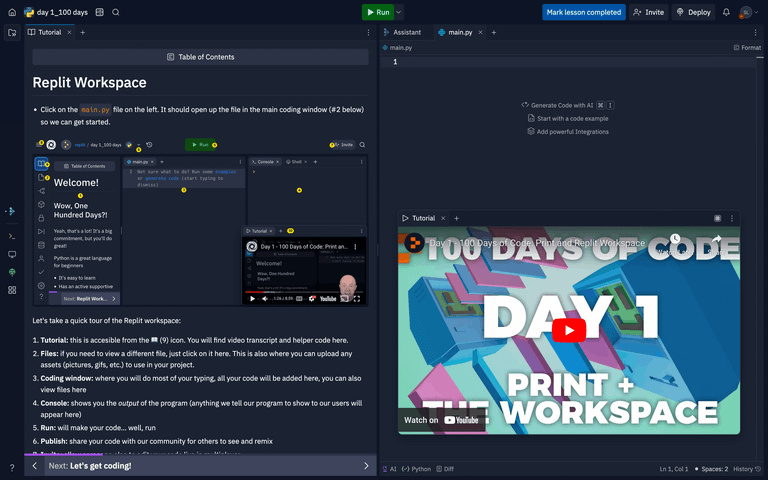
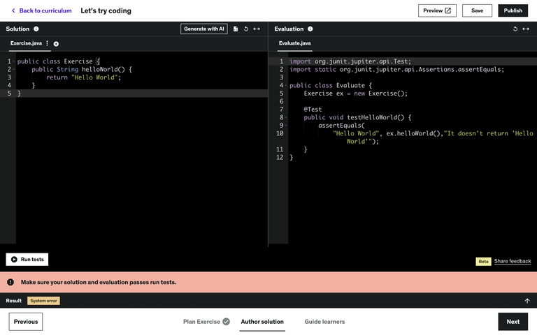
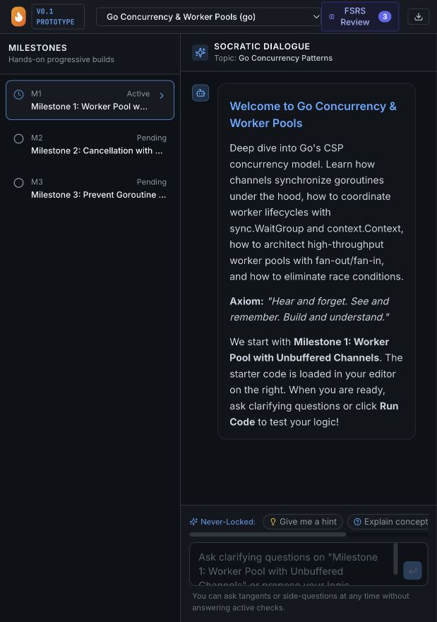
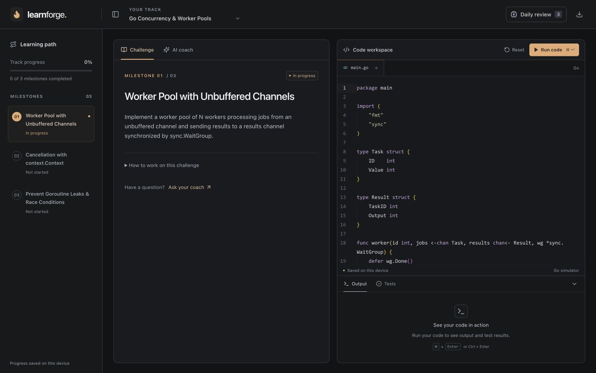
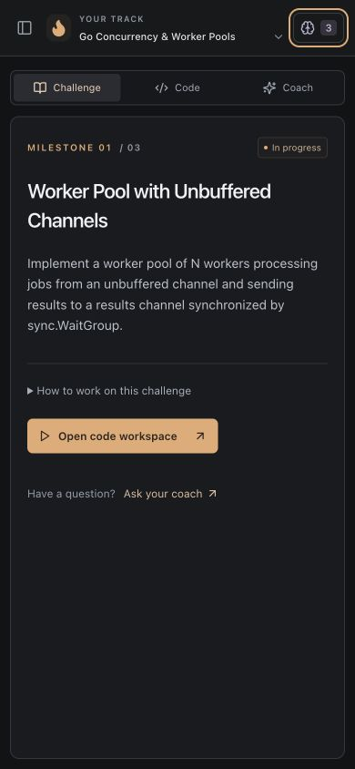
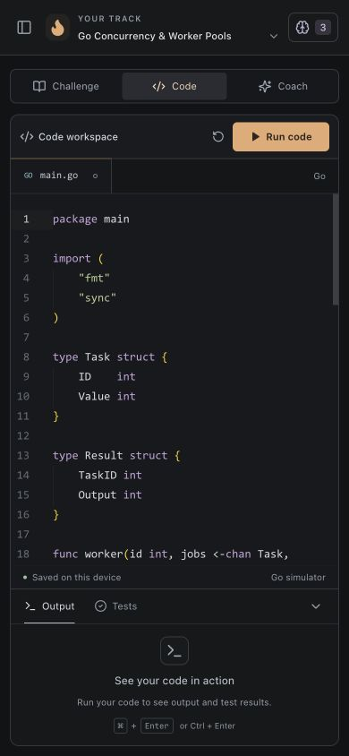
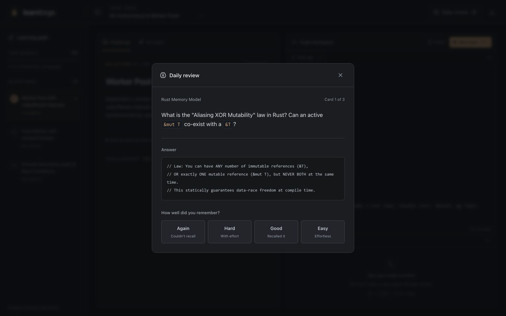

# LearnForge UX/UI research and design decisions

Date: 26 October 2026  
Scope: the existing React/Tauri learning workspace, learning path, AI coaching, code execution feedback, and daily review.

## Design goal

Make it obvious what to work on and how to check the result. The default screen should show the current challenge and its code. Coaching, instructions, and review should appear when needed.

The user’s direction is **modern, consistent, restrained, and less busy**. That means removing repeated controls and explanatory filler as well as improving the visual styling.

## What was confusing in the original app

| Observation from the app and source                                                                    | Consequence                                                                    | Decision                                                                                                 |
| ------------------------------------------------------------------------------------------------------ | ------------------------------------------------------------------------------ | -------------------------------------------------------------------------------------------------------- |
| The task description was not presented independently of the conversation.                              | Learners had to infer their task from the welcome message and milestone title. | Make the actual milestone prompt the default view.                                                       |
| A track selector, topic label, milestone badge, welcome heading, and sidebar repeated related context. | Too many competing orientation cues.                                           | Keep the track in the header and the active milestone in the brief. Remove the duplicate course heading. |
| The chat input, three AI actions, and implementation terminology were always present.                  | The screen encouraged several actions before establishing the task.            | Put the composer and coaching actions inside the coach view.                                             |
| Long milestone titles were truncated.                                                                  | Learners could not distinguish some tasks without selecting them.              | Allow titles to wrap and show one clear selected state.                                                  |
| Below the desktop breakpoint, the code editor was hidden without an alternative route.                 | The principal learning activity became inaccessible.                           | Provide one mobile navigation row: Challenge, Code, Coach.                                               |
| Selecting another milestone replaced editor contents with starter code.                                | Navigation could lose unfinished work.                                         | Save a separate local draft for every milestone and restore it when revisited.                           |
| Review cards were removed from the due list while the modal advanced its array index.                  | A shrinking list could skip cards.                                             | Use a snapshot of the queue for each review session.                                                     |
| The header claimed the model was connected without checking it.                                        | A decorative status could mislead users.                                       | Remove the unverified connection claim; report actual request failures in the conversation.              |
| A language selector allowed Rust even though no Rust runner exists.                                    | Running Rust could fall through to an unrelated runner.                        | Keep the course language fixed and explicitly disable unsupported Rust execution.                        |

## Research method and evidence limits

Inspected the source and captured the running app. Searched Lazyweb from three angles: coding lessons, learning-path progress, and AI/editor layouts. Selected two desktop references whose screenshot descriptions directly matched the workspace problem. Supplemented these with primary product documentation and usability guidance.

These references support design choices. They do **not** establish measured improvements for LearnForge. No user interviews, controlled usability study, or A/B test was conducted.

## Sources and what applies

### 1. Codecademy: keep assistance beside the work

[Codecademy: learning-environment improvements](https://www.codecademy.com/resources/blog/new-learning-environment-platform-features) describes asking for explanations without leaving the course. The useful pattern is help in context, rather than an additional destination.

**Applied:** the coach shares the learning pane with the challenge; it receives editor context. Switching to coaching does not replace the code workspace.

### 2. Codecademy: use familiar editor behavior

[Codecademy: tools within the learning environment](https://help.codecademy.com/hc/en-us/articles/23368252603163-Tools-within-the-Learning-Environment) documents editor controls such as wrapping, autocomplete, and display options.

**Applied:** a real, locally bundled Monaco editor; a recognizable filename; nearby reset and run controls; an output area beneath the editor. Avoid adding settings to the primary toolbar before they are needed.

### 3. Scrimba: connect an attempt to useful feedback

[Scrimba: instant code feedback](https://scrimba.com/articles/instant-feedback/) describes challenge feedback that helps learners make progress while retaining the problem-solving step.

**Applied:** running code exposes output or test results immediately. The interface distinguishes running, success, error, and no-output states. Asking for a hint remains separate from completing the task. LearnForge uses its existing runners; it does not adopt Scrimba’s LLM evaluation system.

### 4. Nielsen Norman Group: remove low-value information

[NN/g: aesthetic and minimalist design](https://www.nngroup.com/articles/aesthetic-minimalist-design/) recommends keeping information that supports the user’s task and progressively disclosing other detail.

**Applied:** remove the duplicate course heading, persistent chat composer from the challenge view, promotional copy, repeated review card, decorative prototype badge, and generic three-step walkthrough. Keep optional instructions in a disclosure. Use one visual primary action: Run code.

### 5. Nielsen Norman Group: communicate actual state

[NN/g: visibility of system status](https://www.nngroup.com/articles/visibility-system-status/) explains why users need timely feedback and a clear sense of where they are.

**Applied:** actual milestone completion, a selected learning-path item, local-save state, execution feedback, and a next-milestone action after tests pass. Avoid claiming service availability or completion without evidence.

### 6. W3C: contrast and keyboard access

[W3C: contrast minimum](https://www.w3.org/WAI/WCAG22/Understanding/contrast-minimum.html) specifies a minimum 4.5:1 contrast ratio for ordinary text and 3:1 for qualifying large text.

**Applied:** readable neutral text, visible focus indicators, text alongside status colors, labels for icon controls, keyboard tab navigation, and a native modal dialog with Escape dismissal. Reduced-motion preferences suppress optional transitions and editor scrolling/cursor animation. These changes are not a claim of full WCAG conformance; assistive-technology testing remains useful.

## Visual references

[Selected Lazyweb research](https://www.lazyweb.com/agentic-search/14352bd6-9506-4dbf-bf8d-2e653e90f717) (account access may be required).

| Reference                                   | Verified screenshot content                                                                         | Adaptation                                                                                                                                 |
| ------------------------------------------- | --------------------------------------------------------------------------------------------------- | ------------------------------------------------------------------------------------------------------------------------------------------ |
| Replit desktop tutorial workspace [Lazyweb] | Navigation/table of contents, a coding window, a console, and tutorial content in a dark interface. | Separate navigation from the workspace and keep instructions close to code. Do not copy the embedded video or extra panes.                 |
| Udemy coding exercise [Lazyweb]             | Side-by-side solution/evaluation editors, a run-tests control, and a visible system-error message.  | Put execution controls beside the editor and show feedback in a predictable location. LearnForge does not need a second evaluation editor. |





## Information architecture

```text
Header:       learning track                 daily review · export
Learning path: progress + milestones         (collapsible)
Workspace:    challenge | coach               code editor
                                             output | tests

Narrow screen: Challenge | Code | Coach
               one active view at a time
```

The main learning loop is **read the challenge → edit code → run → inspect feedback**. Coaching is available at any point through its tab. Review and export remain secondary header actions.

## Visual system

| Element      | Decision                                                                                                                   |
| ------------ | -------------------------------------------------------------------------------------------------------------------------- |
| Background   | Neutral charcoal, with small surface differences to separate the app shell and workspace.                                  |
| Accent       | Muted warm amber (`#e5aa72`) for the run action and selected states.                                                       |
| Other colors | Green for successful execution; muted red for errors. Syntax colors belong to the editor.                                  |
| Typography   | System sans-serif for the interface; monospace for code. Main challenge copy is 14px, with a larger task heading.          |
| Spacing      | Repeat a small spacing scale; align pane headers and use consistent internal padding.                                      |
| Controls     | Compact rectangular buttons, modest radii, and restrained borders.                                                         |
| Motion       | Functional loading feedback; no decorative pulsing service indicators. Respect reduced motion.                             |
| Language     | Task-oriented labels: Challenge, Coach, Run code, Output, Tests, Daily review. Keep backend terminology out of navigation. |

### Rules for future changes

- Add an element only when it supports a specific task or answers a real question.
- Prefer one clear primary action per working state.
- Avoid repeating a heading, statistic, shortcut, or call to action in multiple adjacent places.
- Keep help near the task, with optional detail collapsed by default.
- Use existing spacing, color, button, and typography rules before inventing another variant.
- Avoid decorative gradients, glass panels, glowing borders, ornamental dashboards, fake activity, and motivational filler.
- Preserve unfinished work when users change context.
- Treat a blank output panel, execution without printed output, failed execution, and passing tests as different states.
- Keep all essential activities available at narrow widths.

## Implementation and verification

Implemented in the application, not just a mockup:

- Focused challenge/code layout and contextual coach view.
- Single mobile navigation row; collapsible learning path.
- Per-milestone code drafts and remembered track/milestone selection.
- Locally bundled Monaco, lazy loaded separately from the learning interface.
- Working run shortcut, reset with an inline discard check, collapsible output, and visible test counts.
- Daily-review queue snapshot, native dialog behavior, clearer labels, and removal of unsupported interval promises.
- Completed milestone state updated immediately after successful tests.
- Removed the unverified model-connection badge and unsupported Rust run behavior.

Verification:

- Production build: passed (`npm run build`). Vite reports the documented editor-bundle size warning.
- Existing automated tests: 16 passed across 3 files (`npm test`).
- Desktop layout and phone layout (390 × 844): inspected in the browser.
- Draft edited, switched away from, restored, and reloaded: preserved.
- Reset safeguard and Undo reset: exercised; the previous draft was restored.
- Due-review queue: all three cards presented in order and completion reached, using an isolated preview origin to protect the main workspace’s review schedule.
- Mobile Challenge → Code → Coach navigation: mouse and arrow-key behavior exercised.
- Small-screen path drawer: background becomes inert, Escape closes, and focus returns to its trigger.
- Daily-review Escape dismissal: focus returns to Daily review.
- Rust track: missing milestones now initialize; editing is available and execution is explicitly disabled.
- Go execution failure: diagnostic output appears without discarding code.
- Reduced-motion handling is implemented in CSS and editor options. A full assistive-technology and accessibility-conformance audit has not been performed.

## Remaining product issues

- The existing built-in Go simulator reports `Unexpected reserved word` for the seeded worker-pool example. The UI now displays that failure clearly. Supporting full Go semantics requires separate runtime work.
- Rust execution is not implemented. Editing and coaching remain available; Run code is disabled with an explanation.
- AI coaching depends on the configured local AI service. UI validation does not establish the quality or availability of that service.
- Code and learning progress live in browser/device storage. Clearing that storage removes them; cross-device synchronization is outside this change.
- Monaco increases the production bundle size. It is bundled locally and split from the learning shell to avoid dependence on an editor CDN.

## Screenshots

Original narrow-screen workspace:



Final desktop workspace:



Mobile challenge and code views:





Daily review after consistency changes:



## Current microinteraction research

A second pass used Exa semantic search with domain filters for primary design-system and accessibility sources. Searches covered motion, feedback/error recovery, and accessible interaction. The API key was used for that research request only; no credential is part of the application or this document.

“State of the art” here means current, well-supported interaction practice suitable for a technical workspace. It does not mean adopting every new visual treatment or animation API.

### Primary findings

| Source                                                                                                                                                                            | Finding                                                                                                                                                                                                                                | LearnForge decision                                                                                                                                                                                                          |
| --------------------------------------------------------------------------------------------------------------------------------------------------------------------------------- | -------------------------------------------------------------------------------------------------------------------------------------------------------------------------------------------------------------------------------------- | ---------------------------------------------------------------------------------------------------------------------------------------------------------------------------------------------------------------------------- |
| [Apple HIG: Motion](https://developer.apple.com/design/human-interface-guidelines/motion)                                                                                         | Motion should serve a purpose, stay brief, remain optional, and avoid taxing frequent interactions. The current page includes September 2025 updates.                                                                                  | Short opacity changes for newly revealed content; immediate controls; no full-pane sliding or repeated decorative movement.                                                                                                  |
| [Apple HIG: Feedback](https://developer.apple.com/design/human-interface-guidelines/feedback)                                                                                     | Put routine status near the affected item. Match interruption to the consequence of the event.                                                                                                                                         | Save state lives beneath the editor. Reset checks stay beside Reset. No toast for every edit or successful run.                                                                                                              |
| [Carbon: Motion](https://www.carbondesignsystem.com/building-blocks/foundations/motion/overview), updated August 2026                                                             | Distinguishes quiet productive motion from occasional expressive movement; defines short durations for small interactions.                                                                                                             | Shared 110ms and 150ms timing tokens and one productive easing curve. Remove celebratory confetti.                                                                                                                           |
| [Material 3: Motion physics](https://m3.material.io/styles/motion/overview/how-it-works)                                                                                          | Current expressive motion uses spring attributes and supports interrupted/retargeted movement. [Its older easing guidance](https://m3.material.io/styles/motion/easing-and-duration) is explicitly described as legacy for components. | Do not present old Material timing tables as the latest component system. Springs are useful for gesture-driven movement; this workspace currently needs short state changes, so it does not need a new animation framework. |
| [NN/g: Error-message guidelines](https://www.nngroup.com/articles/error-message-guidelines/)                                                                                      | Errors should identify the problem, preserve input, and help recovery.                                                                                                                                                                 | Retain code on execution failure; show diagnostic output; preserve reset contents for an explicit Undo reset action.                                                                                                         |
| [W3C: Animation from interactions](https://www.w3.org/WAI/WCAG22/Understanding/animation-from-interactions) and [Technique C39](https://www.w3.org/WAI/WCAG22/Techniques/css/C39) | Nonessential motion should be suppressible, including through system motion preferences. SC 2.3.3 is an AAA criterion.                                                                                                                 | Disable optional CSS transitions/animations under reduced motion; text and selected states still communicate the result.                                                                                                     |
| [web.dev: Keyboard and focus guidance](https://web.dev/articles/a11y-tips-for-web-dev)                                                                                            | Keep actions keyboard accessible, make focus visible, and manage focus within composite controls.                                                                                                                                      | Arrow/Home/End navigation within tabs; native dialog focus behavior; Escape, focus containment, and focus restoration for the small-screen learning-path drawer.                                                             |

### Interaction specification

These timings are implementation choices informed by the research, not universal usability thresholds.

| Trigger                                  | Response                                                                                                               | Timing / rule                                                                                          |
| ---------------------------------------- | ---------------------------------------------------------------------------------------------------------------------- | ------------------------------------------------------------------------------------------------------ |
| Hover or press a control                 | Small background, border, or brightness response.                                                                      | 110ms; no bouncing or layout movement.                                                                 |
| Switch learning content                  | Newly revealed content fades in briefly.                                                                               | 110ms; content and controls are usable immediately.                                                    |
| Edit code                                | Editor changes immediately; save status becomes Saving changes, then Saved on this device.                             | Local persistence debounced by 350ms. Flush on navigation/page exit. Display storage failure honestly. |
| Run code                                 | Button shows Running, duplicate runs are disabled, output opens, and a completion/error state replaces the busy state. | Based on actual runner state; no invented percentage or forced minimum delay.                          |
| Reset code                               | Inline discard check; after reset, an Undo reset action restores the prior contents.                                   | The undo action remains until another edit, undo, or context change; no short countdown.               |
| Open daily review                        | Dialog appears with a short fade and contained keyboard focus.                                                         | 150ms. Escape closes it and restores focus.                                                            |
| Complete a milestone                     | Completed state, progress, and a next-step action update.                                                              | Brief feedback; no confetti overlay.                                                                   |
| Open the learning path on a small screen | Focus enters the drawer; the background becomes inert. Escape/backdrop/close dismiss it.                               | No animated overlay choreography. Focus returns to the trigger.                                        |
| Enable reduced motion                    | Optional transitions and animations stop.                                                                              | Static labels, focus, and selection still work.                                                        |

### Deliberate exclusions

No animated cursor effects, parallax, ambient pulsing, glassmorphism, ornamental counters, springy buttons, automatic sound, or a new motion dependency. Browser View Transitions and gesture physics can be evaluated if the app later gains navigation that benefits from spatial continuity; they are not prerequisites for this workspace.

## Review of supplied screenshots

The supplied images identified a harsh square focus outline on the track selector and a visually separate review dialog. The selector now uses a rounded, subdued focus treatment. Review uses the workspace’s typography, neutral surfaces, and consistent controls. Topic labels no longer introduce a separate blue accent, rating choices no longer compete with four different color systems, questions render inline code properly, and the answer has one surface instead of nested cards. Revealing an answer focuses the answer region for reading, rather than automatically highlighting a rating choice.
